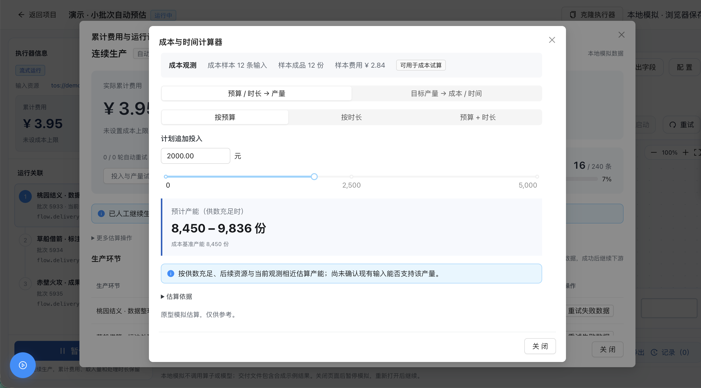

# 产能估算随样本刷新消失修复

2026-11-11。修复“小批次自动预估”在配置未变化时显示、消失、再恢复的问题。

## 根因

240条输入首次12条收尾、此后约每5条刷新。旧算法把不足一个完整分组的尾部也拿来判断零产出；17、38条等刷新点尾部恰好为失败输入，于是整批估算被判为不可用。38条样本实际已有37份成品，样本费8.79元。该问题由样本分组触发，与经过多少秒无关：处理间隔为0、1.2秒及120秒的重放在相同样本点出现相同故障。

## 当前规则

- 基准单价使用全部冻结样本费用÷对应最终成品数，保留失败、重试和零产出费用。
- 不足一组的尾部计入基准；波动范围只比较完整等长分组。
- 完整分组零产出时保留基准，明确提示范围未确定；不丢弃失败组后生成有限范围。预算、目标及追加试算都支持只显示基准。
- 首次样本不足、整批零成品、缺失或无效记录仍不能估算。并未用缓存或固定结果掩盖真实依据不足。
- 演示仍由手动开始触发；本次没有变更输入/TOS统计范围。

## 验证

132项测试、lint、类型检查、静态构建通过。回归测试先复现失败，再对同一实际模拟执行路径连续重放两轮，覆盖全部240条输入及多个刷新点；基准不再无故消失。

真实浏览器保持预算1577.54元、配置不变，逐点观察至82条样本，包含原截图38条样本：基准产能6640份，经验范围5842–7512份。暂停及刷新后仍可使用已有观测。另验证完整零产出分组在预算、目标和追加方向保留基准，以及整批零成品不展示估算。可见Chrome通过系统辅助功能操作，截图保留38条样本的原故障位置。

可复用浏览器检查：`DEMO_ORIGIN=<站点根地址> node scripts/check-executor-capacity.cjs`（环境需可用Playwright与Chrome；也可通过PLAYWRIGHT_MODULE指定模块）。该检查沿正常驱动等待处理与刷新，随后测试暂停、重载和零产出分组边界。自动测试中的fixture重放不代表真实生产账单已接入。

正式规则已同步飞书E1.4；公开网页发布后的复验结果和截图追加到云端验收清单。

