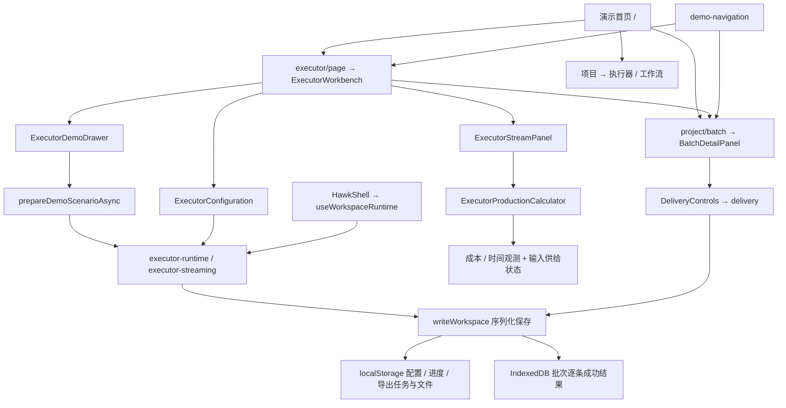

# 执行器二期：需求与实现地图

正式需求以飞书云文档为准。本页解释原型结构，不能代替生产技术设计。

## 需求、入口与归属

|需求|页面和可操作入口|主要实现|
|---|---|---|
|B1 交付文件与阶段性交付|批次底部交付文件：导出、记录；结束方式菜单|project/delivery-controls、data/delivery|
|B2 批次异常处理|失败详情、节点重试、通知强度及梯度告警|project/batch-detail-page、batch-common-controls、data/batch-common|
|B3 批次运行信息|批次时长、配置、批次信息及输入/交付分区|project/batch-detail-page、data/workspace-runtime|
|E1.1—1.3 流式运行与控制|输入及执行器配置、一键运行、继续运行、右下演示抽屉|pipeline/executor-workbench、executor-configuration、executor-demo-drawer；data/executor-streaming|
|E1.4—1.6 成本、时间、计算器|累计费用卡片→运行详情→投入与产量试算|executor-stream-panel、executor-production-calculator；executor-stream-estimates、executor-time-estimates、executor-observation|
|E1.7 运行数据对接|只读观测数据，预留上游集成；不自动补量|data/executor-streaming 中的观测输出|
|E1.8—1.9 提醒与反馈|费用阈值事件及反馈示意；真实飞书发送/回调待生产联调|费用事件和 batch-common 通知记录|
|E2 失败恢复|暂停后批次重试；运行详情环节表重试失败数据|retryStreamStage、阶段恢复队列、executor-runtime|
|E3 克隆复用（P1）|右上克隆执行器|ExecutorCloneButton、cloneExecutor；真实字段推导未接入|
|E4 状态反馈|主运行按钮、状态标签、确认与错误提示|executor-workbench + canExecutorAction|

## 调用与数据路径

## 保存、运行与跳转

- 访问者自己的浏览器保存数据；GitHub只托管静态网页，没有远端任务进程。localStorage键为 `annotation-demo.local-workspace.v2`，逐条成功结果保存在IndexedDB的 `batch-results`。工作流发布快照另外按版本保存。
- 同源、同浏览器页面共享同一工作区；刷新从本地恢复。换浏览器、设备或清理站点数据不会同步。浏览器禁止存储或空间不足时提示保存失败，不假报成功。
- 全站一个模拟驱动，Web Lock避免多个标签页同时驱动。后台页停止推进；返回前台从保存状态接着处理，不补算离线时间。真实生产服务需要研发独立实现。
- 演示重用同一组专属批次，编号不能与其他执行器相撞；重置时清空该演示的结果并更新输入关联。成本场景550步预热分段让出主线程，切换时暂停其他模拟任务。
- 同一页面只改查询参数时通过Next原生History集成更新，避免GitHub静态托管请求不存在的查询专属RSC。浏览器返回、前进与刷新保留语义。不同页面沿GitHub仓库basePath跳转。
- 拆repo不会减少同一浏览器的计算；不同域名还会隔离本地存储。本轮保留一个静态站点，限制运行数量、数据量和同步计算。模拟上限10,000条；200万条采样仅用数学边界检查。

## 2026-11-11 查到并修正的问题

1. 计算器量程与刻度不一致导致标记重叠；金额大值被输入框截断。
2. 页首混用成本样本和独立时间观测；正时长显示成0.00小时。
3. 明确供数耗尽仍展示理论产能；现在显示当前输入新增0份，正数目标提示补充资源。
4. 首次场景切换请求静态站点查询专属页面，可能白屏等待；改为同页查询更新。
5. 演示在局部工作区分配批次编号，与已有示例碰撞，显示其他批次统计；现在全局分配后稳定复用，并修复已有碰撞。
6. 原6条恢复示例缺少第二环节失败；改为12条，能够真正演示第二环节失败及下游接续。

真实GUI记录将单独保存操作、画面与结论，不以脚本通过代替GUI验收。
