# 执行器二期：流式运行、成本与复用

# 一、文档说明

## 基本信息

| 项目 | 内容 |
|---|---|
| 所属项目 | 机器标注平台／执行器二期 |
| 状态与版本 | v2026.11.05 界面对齐与验收补充稿；直接启动、持续估算/独立成本上限、有限重试与人工补救、可选目标量停取入均已确认；无效单条成本输入已移除；时间→产量为 P2 必做需求，当前待实现；生产能力未验收 |
| 负责人／排期 | 待确认；不得从会议计划推断上线 |
| 资源 | 产品、设计、前后端、测试；投入待确认 |
| 上下钻入口 | [需求总览](https://fyze31atzb.feishu.cn/docx/BzMZd9CVLoNxtPxx4b2czeronse) · [执行器二期](https://fyze31atzb.feishu.cn/wiki/VTzeweL4IiJ5WDkkV77cs5G2nNd) · [批次共用能力](https://fyze31atzb.feishu.cn/docx/VZwGd6aUioGjAjxYhupcVW3hnPh) · [一期基础](https://fyze31atzb.feishu.cn/wiki/PoWywcoIcim273kN4G7c2TBInnd) |

## 文档版本

| 版本 | 变化 | 来源 |
|---|---|---|
| 2026-10-19 | 二期旧云稿；固定金额、成功率与补救规则有历史冲突 | 原云文档版本历史 |
| 2026-10-21／22 | 有限首轮后重试、原位补救及共用优化修正 | 本地最终修改包、10/22会议及优化文档 |
| 2026-11-03 原导出稿 | 时间区间重叠完整导出、原快照重试 | 同日交付反馈，原导出文档 |
| 2026-11-03 本次整合 | 总览＋两份详稿；公式成品预算、模式拆分、范围与原型同步 | 用户逐项确认与批准实施计划 |
| 2026-11-04 界面对齐 | 合并已确认的直接启动、持续估算/独立成本上限、有限重试与人工补救；确认目标量是可选停取入上限，时间→产量纳入低优先级必做开发范围 | 当前线上界面、提交 ee92646、本地验证材料及用户确认 |
| 2026-11-05 原型验收与界面可读性 | 用户反馈整体无重大问题；将成本、时间、取入和重试配置分组，补充语义图标；演示工作流及人员名使用三国演义题材匿名化 | 用户线上验收反馈及截图 |
| 2026-11-05 成本配置确认 | 移除不参与预测的单条成品成本上下限；持续成本估算继续由已收尾样本驱动，旧存值仅兼容读取 | 用户确认移除无效输入 |
| 2026-11-05 成本上限动作确认 | 实际成本触顶时可选择停止新增并收尾，或按通知强度提醒并继续；预测成本不阻断生产 | 用户确认当前执行规则 |

原文保留在飞书版本历史及本地写入前快照。E01–E14 记录此前已确认的业务基线；其中已被 2026-11-04 用户决定替代的部分在增量规则中标为删除线，当前规则以 4.2.1 为准。4.4 保留界面事实及尚未确认项；合成数据不代表生产服务已接入。

# 二、需求背景

业务需要在长链路未整批结束时持续获得成品，并知道每份最终成品的投入是否值得。10/21修正未同步到旧云稿，11/2会议又说明一对多转化和样本代表性风险，11/3会议指出失败输入不能仅靠rowkey即时恢复。当前需要把运行方式、成本决策与人工补救拆清，避免沿用互相冲突的旧规则。

# 三、需求范围

| 优先级 | 范围 | 边界 |
|---|---|---|
| P0 | 流式就绪结果下传、持续成本/产量估算、独立可选成本上限、可选目标成品量停取入、提醒与有序收尾、有限重试、原位补救、必要关联 | 观察样本用于估算，不阻挡启动；整批保留三模式 |
| 2026-11-04 原型增量 | 直接启动、运行中成本/产量试算、独立成本/输入/时长/目标量上限、有限自动重试、人工阶段补救及本地存储 | 目标量留空不按目标停机，达到已填目标后停止新输入、在途收尾；时间→产量当前不可估算，按 P2 待实现；生产能力未验收 |
| P1 独立排期 | 克隆实际配置、可选输入、字段重算与结果隔离 | 不要求与流式同批交付；负责人及日期待确认 |
| P2 低优先级必做 | 时间→产量估算 | 纳入后续研发范围；有有效吞吐数据时按投入时长估算产量，数据不足时说明原因；具体数据口径和排期需研发评审 |
| 后置 | 完整逐条一对多链路、跨平台追溯、运行中并发精准重试 | 不将本期必要关联扩大成全平台重构 |

普通批次重试、梯度告警与导出基础行为统一下钻共用能力文档，不再复制第二套规则。

# 四、详细说明

## 4.1 核心业务流程与适用规则

1. 选择已发布工作流并排序→创建→配置固定输入及运行方式。
2. 整批：默认／严谨／目标判定→放行→收尾文件成功→下一环节。
3. 流式配置完成后直接开始处理本次已有输入；不要求先完成样本并确认公式预算。结果就绪即下传。
4. 持续更新已收尾输入的成本与产量估算；预测费用只供参考，不阻断生产或重试。用户可另设总成本上限，并选择触顶后停止新增取入和自动重试、在途任务收尾，或按成本上限通知强度提醒并继续生产。
5. 自动重试次数有限；暂停后可在原执行器内人工补救失败环节。自动重试不以全链成本收益预测作为本轮门槛。克隆另建独立实例，不是补救入口。
6. 目标成品量可选填：留空时不按目标量停机；填入后，达到目标便停止新增输入，在途任务继续收尾，失败数据仍按已配置次数自动重试，最终成品数可能超过目标。成本和时长等其他运行上限继续生效，不因目标达成而放宽。

| 对象 | 含义与口径 |
|---|---|
| 运行方式 | 整批／流式；首次启动锁定 |
| 整批判定 | 默认／严谨／目标，仅整批适用 |
| 控制方式 | 自动／人工；接管为执行器级，不改变运行方式 |
| 预计成品量 | 根据当前依据预测的最终产物数量，可大于输入；预测值本身不触发停取入 |
| 目标成品量 | 用户可选填的停取入上限，与预计成品量分开；留空不按目标停机，达到已填目标后停止新增输入，在途继续收尾并按已配置次数自动重试失败数据，最终产量可超出；其他运行上限继续适用 |
| 时间→产量估算 | P2 必做需求：根据投入时长及有效吞吐数据估算新增可交付产量；数据不足时显示不可估算原因，当前原型尚未实现有效数据下的估算 |
| 成本估算 | 按已收尾输入配对其成本与最终产物，持续更新经验估算；样本不足或缺失时说明不可估算 |
| 总成本上限 | 用户可选独立设置；预测值不触发停机。实际费用触顶后按用户选择停止新增并收尾，或仅提醒并继续生产；停止模式的最终费用可超限 |
| 实际单位成本 | 累计费用÷可交付最终成品数；零成品显示不可计算，不显示0元 |
| 样本转化 | 最终成品数÷样本输入数，允许大于1；不足代表性须提示 |
| 下游进度 | 用阶段自身输入／产物单位；总量未知不伪造完成百分比 |

**执行器工作台呈现补充（2026-11-04）：** 执行器信息区以紧凑方式呈现运行方式、明确标注的输入资源、累计费用与成本上限、交付文件排序。新建后未配置输入时，显示“添加本次输入资源”入口，避免把运行方式标签误认为输入说明；费用摘要不得挤占运行关联列表。运行与上限状态已在工作台中明确呈现时，不再重复显示顶部策略提示横幅。导出结果与导出记录属于批次运行后的操作，放在批次详情的交付区域，不放在执行器信息区。

## 4.2 功能详细说明

当前增量规则以 4.2.1 和 4.3 为准。下面的 E01–E14 保留 2026-11-03 规则基线；与本轮决定冲突的流式启动、预算决策、自动重试门槛和目标量条款已由 4.2.1 替代，其余无冲突规则沿用。

## 4.2.1 2026-11-04 已确认规则增量

以下决定由用户在页面验收前明确确认。原 11 月 3 日文字保留为历史基线；冲突规则用删除线标识，不据此假定生产能力已接入。

| 范围 | 历史基线（被替代部分） | 当前确认规则 | 原型/生产边界 |
|---|---|---|---|
| 流式启动 | ~~先跑完整链路样本，完成后暂停取入并等待人工预算确认~~ | 输入与执行器配置通过后即可启动；观察批量仅供估算，不阻挡开跑。 | 当前为本地模拟；不调用真实算子或模型。 |
| 成本决策 | ~~以人工确认的预计最终成品数×期望单价形成生效公式预算~~ | 按已收尾输入与最终成品持续估算成本/产量；总成本上限是独立、可选设置，不随预测自动变化。样本不足、缺字段或零产出时展示不可估算原因。 | 区间来自合成演示样本的分组经验值，未校准，不是统计置信区间、计费合同或费用保证。 |
| 成本上限动作 | ~~费用达到公式预算即停止新增~~ | 用户选择实际成本触顶后停止新增输入及自动重试、在途任务继续收尾，或按成本上限通知强度提醒并继续生产（含配置次数内的自动重试）。停止模式最终费用可能超过上限。 | 触顶提醒强度取通知设置与全局基准的较高者；原型本地模拟，真实费用和消息服务待接入。 |
| 自动重试与人工补救 | ~~自动重试前必须通过全链成本收益估算门槛~~ | 自动重试设置有限次数；暂停后可在原执行器内人工重试选定失败环节及其下游，保留成功结果和正常队列。 | 本轮不要求全链成本收益预测门槛。真实输入扫描、幂等、权限和资源成本仍需生产联调。 |
| E15 可选目标成品量 | ~~预计成品量只作预算依据，不作为停取入条件；达标后停止新增自动重试~~ | 目标量与预测量分开；目标可选填，留空不按目标停机，达到已填目标后停止新增输入，在途继续收尾，失败数据仍按已配置次数自动重试，最终成品数可能超出目标。 | 用户确认保留有限自动重试；成本和时长等其他运行上限继续生效。生产停止取入、重试和收尾仍需联调。 |
| E16 时间→产量（P2 必做） | ~~正式需求范围待确认，可能仅作为不可估算占位~~ | 纳入后续研发范围，优先级低于 P0/P1；输入投入时长后，具备有效吞吐数据时估算新增可交付成品，数据不足时说明不可估算原因。 | 当前原型只实现不可估算提示；有效数据下的产量预测待实现，真实吞吐、并发与等待数据需接入。 |

目标成品量与时间→产量范围已由用户确认；当前原型能力及开发差距见 4.4。

### 2026-11-03 历史规则基线（供差异追溯，不作为当前验收）

| **序号** | **模块** | **功能** | **功能详细说明** | **用户故事** | **交互/原型图** |
|---|---|---|---|---|---|
| 1 | 创建与方式 | E01 创建后配置本次运行 | **操作与系统响应：** 沿用一期当前路径：选择已发布工作流并确定顺序→创建执行器→配置输入；只引用已发布版本，不引入空容器逐个追加或草稿模板替代流程。；输入及执行器配置中分开选择运行方式（整批／流式）；整批再选默认／严谨／目标判定，流式单独配置样本、成品单价、有限重试和选填提醒比例。；首次启动锁定输入集合、运行方式、链路顺序与发布版本。旧记录缺运行方式时按整批展示，不清除浏览器数据。 **系统记录：** 记录执行器、工作流发布版本、顺序、批次与阶段关联、输入来源、运行方式和首次启动时间；自动／人工控制单独记录。；策略修改保留新旧值、操作者、生效时间与配置版本；前台不新增配置版本管理入口。校验失败或取消保持旧值。 **异常：** 未选发布工作流、输入无效、样本数量超过固定输入或流式策略不完整时阻断启动；已启动后不能借暂停更换输入或运行方式。 **完成标准：** E01-A1：新建顺序不变；整批三模式可用。；E01-A2：旧数据缺省整批；刷新保留原记录；流式不展示整批放行阈值作为运行门槛。 | 作为执行器操作者，我希望在创建后清楚区分运行方式与判定模式，以便沿用现有创建习惯并选择合适策略。 | 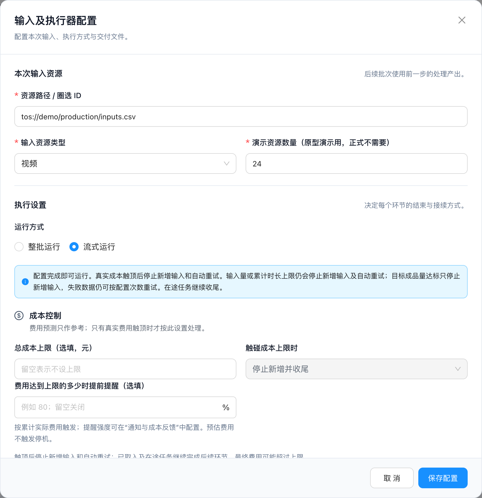 |
| 2 | 整批兼容 | E02 保留三种判定与接续 | **操作与系统响应：** 整批默认模式无失败自动放行、有失败待人工；严谨模式每批计算完均需确认；目标模式按原成功率、有限失败重试与耗尽后等待／继续设置判定。；排除过滤时成功率＝成功÷（总量−正常过滤）；包含过滤时＝成功÷总量，过滤不算成功；分母为零显示不可计算并待人工核对。；只在整批模式沿用“放行→收尾交付文件成功→下一批次”；人工主动导出不构成放行。二期公式成本闭环不套入整批。 **系统记录：** 保留批次成功、失败、正常过滤、重试次数与放行原因，文件任务和接续关系。 **异常：** 目标未达标且无可重试数据、成功率不可计算或必需收尾文件失败时待处理；中间环节依赖文件时不能选无文件结束。 **完成标准：** E02-A1：默认／严谨／目标均保持原行为。；E02-A2：主动导出不推进后续，收尾文件失败恢复后只接续一次。 | 作为已有整批用户，我希望三种判定和交付接续继续工作，以便新增流式能力不影响现有任务。 |  |
| 3 | 样本 | E03 先跑通完整链路 | **操作与系统响应：** 没有可靠转化率时，用户指定正整数样本输入量；规模无业务默认值，不将原型示例的4条当默认。；样本在本次执行器完整走过全部工作流；成功且可读结果及时下传，包含一对多拆分后的产物。样本结束后暂停新增原始取入，等待人工预算确认。；样本费用计入本次累计费用，成功产物保留；正式生产从剩余输入继续，不重跑已处理样本。 **系统记录：** 记录样本来源、选取数量、各环节输入／成功／失败／产物、费用、完整链路完成状态及预测依据；原型使用合成固定顺序，生产抽样方法待确认。 **异常：** 样本未跑通、零最终成品或不足以支持可靠估算时展示无法估算／依据不足，不伪造转化率或零单价；待人工补救、补充验证或调整方案。 **完成标准：** E03-A1：先有下游产物，再完成上游全部输入。；E03-A2：样本待确认期间不取入剩余数据；正式运行无重复样本费用／产物。；E03-A3：零成品无法直接确认正式预算。 | 作为成本负责人，我希望先看到完整链路样本与费用，以便依据实际成品转化确认生产预算。 | 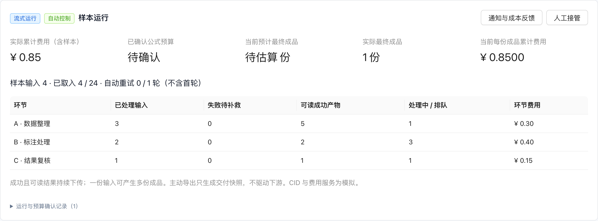 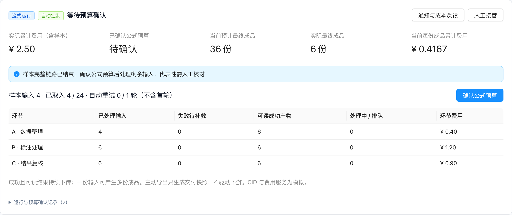 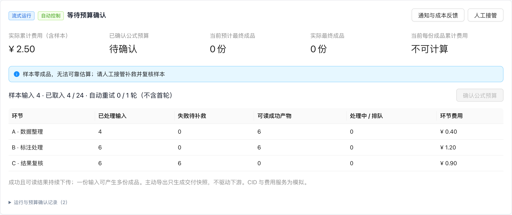 |
| 4 | 公式预算 | E04 人工确认成品预算 | **操作与系统响应：** 以最终成品为计价目标。预算＝人工确认的预计最终成品数×期望最终成品单价；不以原始输入数直接乘单价，也不直接填写固定总额。；样本有可用依据后展示各环节转化、预计成品数、期望单价、公式金额、已发生费用与收尾可能超额说明；用户核对代表性后确认。；一对多产出按真实最终成品单位计数，预计成品量可大于原始输入量。预计成品量只做预算依据，不作为够量停止条件。 **系统记录：** 冻结每次人工确认的数量、单价、公式金额、依据、操作者、时间与版本；可追溯本次生效版本。 **异常：** 输入参数无效、估算依据不足时不生效；确认金额未覆盖已发生费用时提示调整或进入人工处理，不悄悄清零历史费用。 **完成标准：** E04-A1：样本4条产生6份、输入24条的合成示例可预测36份；金额按36×期望成品单价计算。；E04-A2：确认前不得自动处理剩余输入；没有直接固定金额输入框。 | 作为成本负责人，我希望确认基于最终成品的预算公式，以便控制每份成品的经济性。 | 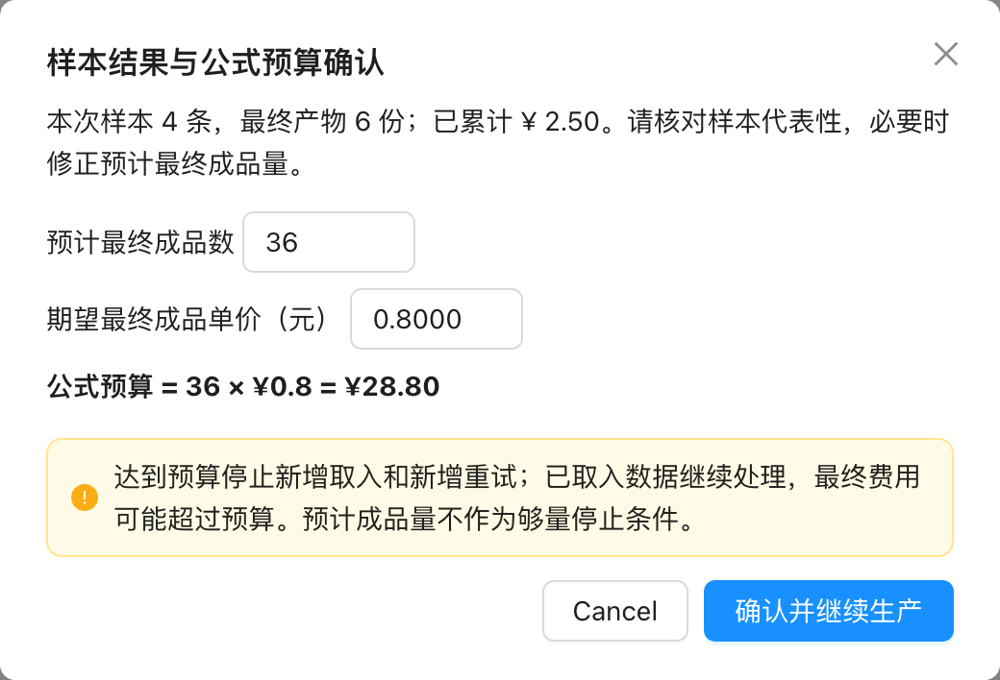 |
| 5 | 预算更新 | E05 预测持续更新，预算确认生效 | **操作与系统响应：** 运行中持续展示预测依据与最新预计最终成品量；区分“当前预测”和“已确认预算”。；预测变化只提示影响；重算入口展示新公式，人工确认后替换生效版本。取消、关闭或尚未确认均保持旧预算，不自动提高费用上限。；暂停后可调整有限重试与选填提醒比例；不得清空费用、样本或已用次数，保存或放宽策略不自动启动。输入、方式、链路及已启动样本规模仍锁定。 **系统记录：** 保留预测更新时间、依据及全部确认历史；同一执行器累计费用不因重算清零。 **异常：** 样本代表性不足、未知后续费用或零产出显示不确定及原因；预算触发收尾后不得靠自动重算重新开闸。 **完成标准：** E05-A1：预测变化后旧预算不变；取消重算不生效。；E05-A2：确认新数量和单价后才切换版本，历史可查。 | 作为成本负责人，我希望预测更新与预算变更分别处理，以便掌握变化而不被自动提高预算。 | 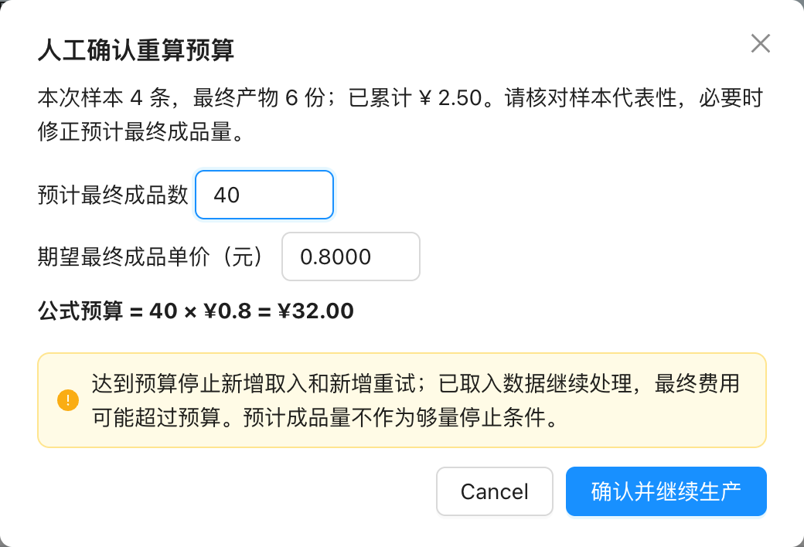 |
| 6 | 流式生产 | E06 固定输入，产物就绪即下传 | **操作与系统响应：** 固定本次输入集合，不动态补货；各环节对成功且可读结果持续消费，不逐批等待人工确认或交付文件。；支持一份输入生成多份中间产物并继续加工；各阶段使用自身输入与产物单位，不强行用初始输入作统一分母。；主动导出仅冻结所选环节当时已完成结果，不暂停计算、不驱动下游；运行结束不以“已达预计成品量”判断。；流式关联批次取消独立开始、结束、重试；保留环节暂停／恢复，局部操作不能绕过执行器整体控制。下游暂停或不可用时保留待推进产物，并减缓上游取入。 **系统记录：** 记录执行器／阶段／批次、就绪结果关联与消费位置，保证同一次成功产物不重复下传；生产可靠读写与幂等接口待联调。 **异常：** 结果成功但资源不可读不得当就绪下传；异常和正常过滤区分展示；无成品时不伪造输出文件或下游成功。 **完成标准：** E06-A1：上游未处理完固定输入，下游已有处理进度。；E06-A2：一对多最终成品数与阶段输入数分别展示；主动导出无调度副作用。 | 作为生产操作者，我希望成功结果持续进入后续环节，以便提前产出可交付成品。 | 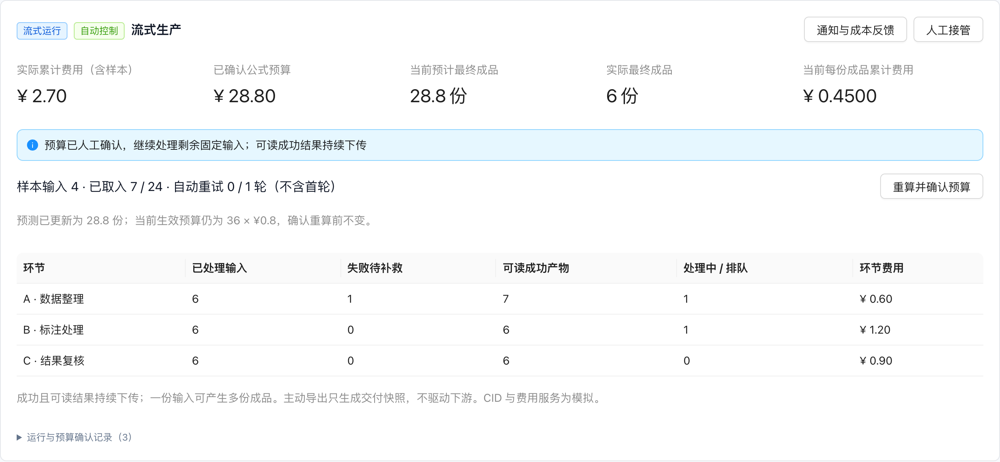 |
| 7 | 费用响应 | E07 提前提醒与预算收尾 | **操作与系统响应：** 可选按预算比例提前提醒；比例由用户输入，无业务默认值。命中后继续运行；预算升级提示与既有通知基准衔接，原型只本地显示。；累计实际费用达到生效公式预算，停止新增原始取入与新增重试；已取入数据继续完成后续首次处理，避免链路中途丢弃。；显示预算、触发时费用、收尾新增费用与最终费用；明确收尾可能超额，此预算是停止新增的阈值，不保证最终费用硬封顶。 **系统记录：** 记录触发时点、触发费用、当时已取入范围、提醒与收尾原因，最终费用与预算差额；真实费用延迟和未结算用量另列。 **异常：** 费用缺失或结算滞后不能展示为已确认零费用；处置与提醒延迟、供应商费用口径待生产联调。不新增成功率不足即整链暂停。 **完成标准：** E07-A1：提醒后继续取入；达到预算后取入数量不再增加，自动重试不再新增。；E07-A2：收尾后费用可大于触发费用，三项费用可核对；后续人工继续／补救不改写原收尾费用，新增费用另计入累计。 | 作为成本负责人，我希望达到预算后有序收尾并看到超额来源，以便控制新增投入且保住已投入数据。 | 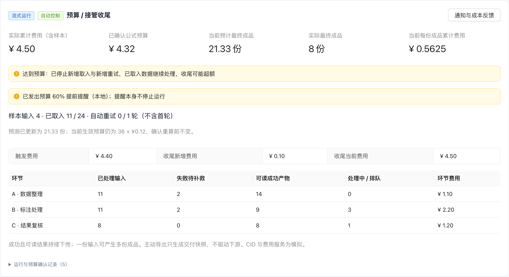 |
| 8 | 自动重试 | E08 首轮后有限逐轮评估 | **操作与系统响应：** 自动重试次数是有限非负整数，不含首轮；0表示关闭。固定输入首轮及对应后续处理全部结束后，才评估下一轮失败数据重试，不能每个批次完成就独立抢跑。；重试前合并已发生、未结算、失败阶段重跑及到最终成品的后续费用，估算新增成品与预计整体成品单价；预算余量和期望成品单价均满足才启动一轮。预计整体单价＝本轮后预计累计费用÷本轮后预计累计最终成品。；只恢复失败范围，保留成功与正常过滤；每轮结束再评估，不无限重试。预算触发收尾和人工接管均关闭自动重试新增。 **系统记录：** 记录评估轮次、失败范围、估算依据、预计后续费用、预计成品收益、允许／暂不重试原因与累计次数。 **异常：** 估算达到预算、收益不满足、样本不足或未知费用时暂不自动重试，展示具体原因并待人工；不能用仅当前失败节点费用冒充全链费用。 **完成标准：** E08-A1：整轮首轮未结束不得自动重试；0不重试、有限次数不越界。；E08-A2：估算含后续处理；依据不足有可见原因；没有整链成功率暂停策略。 | 作为生产操作者，我希望系统只在成本可接受时有限重试失败数据，以便减少无收益投入。 | 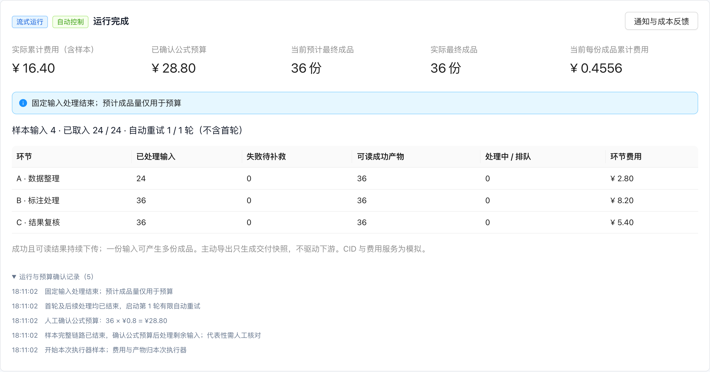 |
| 9 | 人工补救 | E09 执行器级接管与原位恢复 | **操作与系统响应：** 人工接管作用于整个执行器：停止自动新增取入与新增自动重试，已取入数据先收尾，之后在同一执行器选择失败类补救。；补救前明确可能额外计费并确认范围；从可靠输入可恢复的失败阶段继续。普通批次回更早算子不等于允许跨工作流任意回退。；不创建独立补救执行器；已有成功产物、稳定输出CID、批次关联与历史仍属原执行器，费用继续累计。；按环节与错误类别整类预览补救范围、数量、从失败处到成品的预计新增费用与产出，确认后冻结成员；不逐条勾选。已派发尝试等待返回，不与人工并发重复领取；范围变化时拒绝并刷新确认。；人工接管后可明确确认继续剩余固定输入，或整类补救失败；不受自动预算与自动重试次数拦截，但费用累计、平台故障和权限校验仍有效。两类操作不混在一个自动恢复按钮内。 **系统记录：** 记录接管人／时间、失败类别、恢复起点、准备状态、补救轮次、新增费用与新增产物。 **异常：** 只有rowkey标记不能保证完整输入可恢复；需要扫描则先显示准备中。恢复范围或输入不足时保留失败与原因，不假报成功或重复已有成功结果。 **完成标准：** E09-A1：接管后自动策略不再新增。；E09-A2：补救前后执行器和批次标识不变，已有成功结果保留且不重复。原型演示整类失败，按错误码选择与完整成本预估待生产联调。 | 作为异常处理人员，我希望在原执行器集中补救，以便继续追踪同一任务的成本和交付。 | 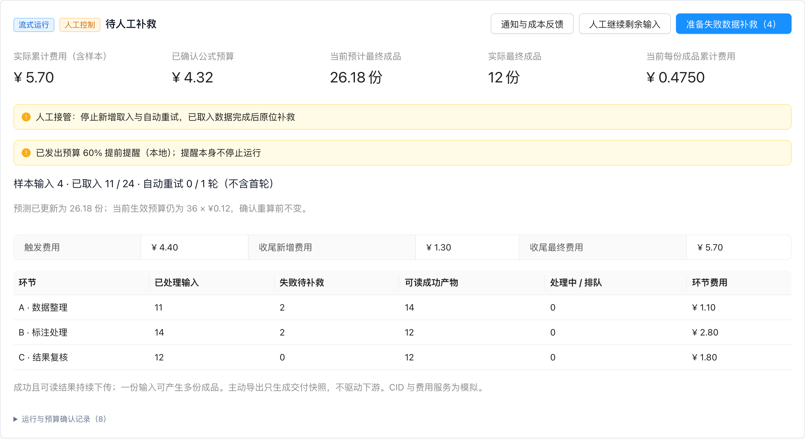 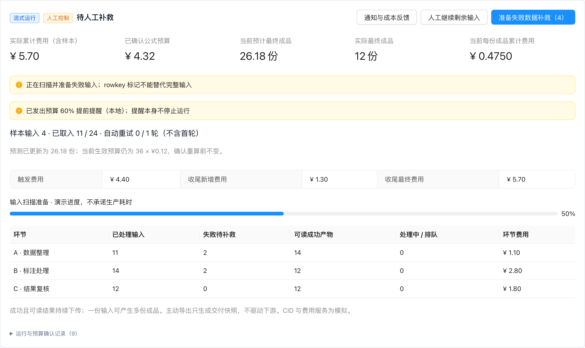 |
| 10 | 关联与进度 | E10 必要关联和阶段口径 | **操作与系统响应：** 本期建立执行器、工作流发布版本、批次、阶段及可靠输入输出的必要关联；展示各环节处理输入、失败、成功产物、排队／处理中、费用。；下游总量尚未稳定时不显示虚假100%或用原始输入硬算成功率；拆分前后分别标单位。完整逐条一对多血缘和跨平台追溯后置。；诊断按环节与稳定错误类别聚合，区分当前失败存量、历史尝试、恢复子集及正常过滤；未知错误归未分类。恢复成功不与成功总数重复相加，不直接相减视频与拆分图片。 **系统记录：** 记录稳定关联标识及必要处理进度，支持刷新后恢复；生产跨服务一致性、读取协议需研发确定。 **异常：** 关联缺失时说明缺口，不按同名节点或全局rowkey猜链路；原型CID为合成标识，不代表真实资源可读性。；保留50万级聚合诉求；真实容量与延迟待研发核定，小规模原型不作为性能通过证据。 **完成标准：** E10-A1：所有阶段可定位自己的批次和已发布版本；一对多不把成品数当输入成功数。；E10-A2：刷新保存记录和预算确认历史。 | 作为运行操作者，我希望按环节查看可靠关联和进度，以便找到阻塞而不被混用单位误导。 |  |
| 11 | 克隆复用 | E11 继承配置，隔离执行结果 | **操作与系统响应：** P1独立排期。克隆前预览执行器、工作流、节点实际配置，默认勾选配置继承；本次输入资源可选继承。；未勾配置项回退其来源发布版本原始配置；来源版本缺失则明确阻断该回退，不能偷偷使用最新草稿。；新建独立执行器与批次；不继承费用、进度、已用重试次数、结果、输出CID、导出记录或已确认预算。新旧结果隔离。 **系统记录：** 记录来源执行器、来源发布版本、配置继承选择、输入选择和新实例关联；只保留单价等意图参数，预算须重走样本公式确认。 **异常：** 所选输入数量小于继承样本规模、依赖版本不存在或配置无效时要求修正，不自动启动；原型展示整组配置继承，逐项节点回退粒度待研发评审。 **完成标准：** E11-A1：克隆后原实例不变，新批次和输出标识独立、费用进度为零。；E11-A2：即使带入输入也没有生效固定总额，重新确认样本预算。 | 作为重复执行人员，我希望复用已调好的配置并隔离结果，以便减少重复配置且不混淆两次任务。 |  |
| 12 | 克隆输入 | E12 按本次输入重算字段依赖 | **操作与系统响应：** 输入可选带入；选择新输入后按本次输入结构重新推导各工作流真实依赖字段和节点绑定，重新绑定本次批次。；上次额外输出字段不应变成新输入的必填空字段；真实执行依赖缺失则阻断启动并定位缺失字段和相关节点。；不复制上次结果容器或输出CID来冒充新输入。 **系统记录：** 保存本次字段映射、校验结果与来源版本，不继承旧输出运行数据。 **异常：** 生产字段依赖识别、自动推导接口和可编辑边界待研发评审；原型仅展示配置预览和新实例隔离，不宣称已完成真实字段重算。 **完成标准：** E12-A1：用无关额外字段的旧结果克隆后，新输入不因该字段为空报错。；E12-A2：真正依赖字段缺失时阻断且可定位；本项需生产联调验收。 | 作为复用配置的操作者，我希望只校验新输入真正需要的字段，以便更换输入时不被旧输出污染。 |  |
| 13 | 成本反馈 | E13 固定抽样评价与主动漏报报告 | **操作与系统响应：** 保留10/21确认的反馈闭环：每个新成本提示固定约50%抽样，刷新、返回或重复触发不重抽；用户返回点击运行时，抽中且未反馈才邀请整次提示准确性评价。；保留主动报告“有问题但未提醒”：无需历史成本提示，选择受影响批次并填写说明。反馈与运行操作分别处理。；保存反馈不等于人工接管，不自动修改预算、不暂停或启动；仍有自动限制时不得借反馈绕过。原型提供固定抽样记录和主动反馈入口，运行时邀请编排待生产联调。 **系统记录：** 保存提示稳定身份、抽样结果、评价或漏报类型、说明、用户、执行器、批次、当时配置与可获得费用／成品指标；未知如实记。 **异常：** 没有受影响批次或说明时阻断主动报告；保存失败保留输入。准确性评价与主动报告分别分析，不能从报告数推算漏报率。 **完成标准：** E13-A1：同一提示刷新不重抽；未抽中或已反馈不重复邀请。；E13-A2：无历史提示可主动报告，保存前后控制方式、预算和运行状态不变。 | 作为成本负责人，我希望评价提示并主动补充漏掉的问题，以便帮助后续核查准确性。 | 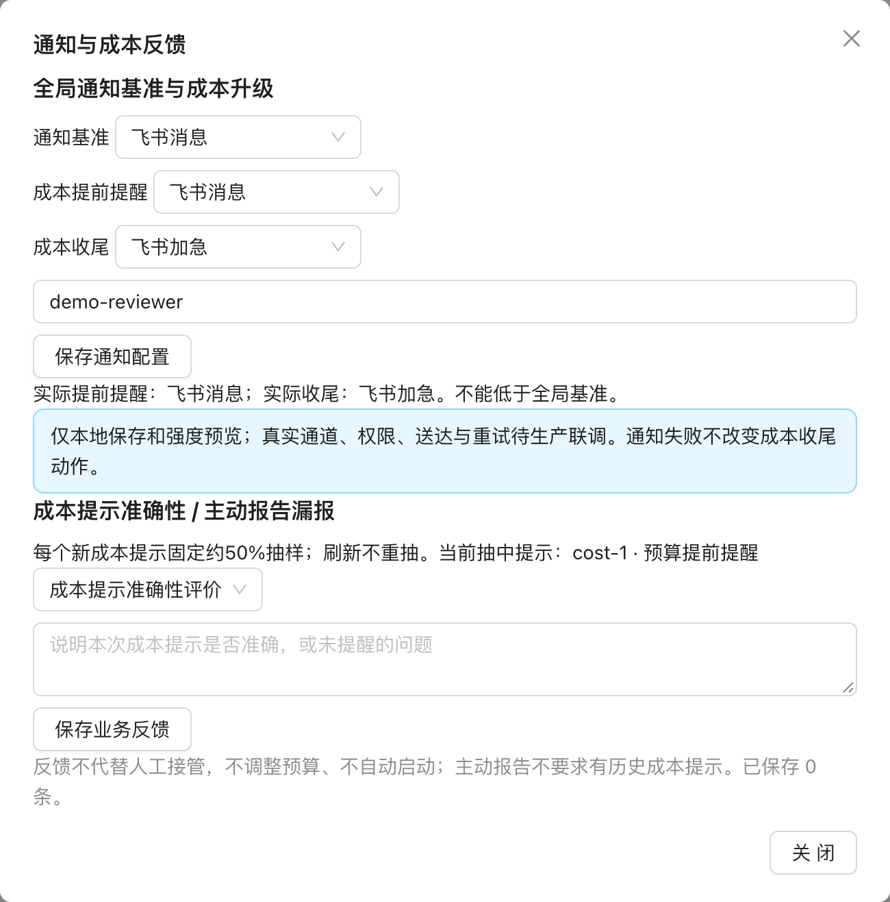 |
| 14 | 全局通知 | E14 共同接收人与成本事件升级 | **操作与系统响应：** 保留全局通知基准与共同接收人，成本提前提醒和收尾允许单独升级；实际强度取全局基准和事件设置中较高者，不得降低基准。；沿用现有五档通知能力；批次异常继续沿用共用告警规则，只通知不暂停。费用动作不因消息发送失败而撤销。；提示应含项目、执行器、关联批次、费用／预算、采取动作与入口，不含原始资源正文。 **系统记录：** 记录稳定事件身份、基准、事件设置、实际强度、接收人、配置版本、发送结果与重试；持续同一事件去重，升级可追加。 **异常：** 有效通知须有接收人；真实通道不可用应禁用或明确失败，不假报送达。原型只展示强度合成与配置，短信／电话等实际能力待联调。 **完成标准：** E14-A1：事件设置低于基准时实际强度不降低。；E14-A2：通知失败不改变预算收尾；开始／结束、批次梯度与成本通知分别核对。 | 作为值守负责人，我希望设置统一的通知底线并升级重要成本事件，以便收到足够强度的提醒。 |  |

## 4.3 验收场景与状态

| 场景 | 可观察结果 |
|---|---|
| 整批兼容 | 默认失败待处理、严谨每批确认、目标有限重试；收尾文件成功再接续 |
| 配置后启动 | 配置完成即可启动；观察批量不阻挡开跑，启动后输入、方式与链路锁定 |
| 持续成本与产量估算 | 随已收尾输入持续更新；与独立可选成本上限分开；样本不足、缺字段或零产出时说明不可估算原因 |
| 成本上限动作 | 预估费用不阻断生产或重试；实际费用触顶后按配置停止新增并在途收尾，或按通知强度提醒并继续生产 |
| 有限重试与人工补救 | 自动重试次数有限；暂停后可人工补救失败环节；不要求全链成本收益预测门槛 |
| E15 目标成品量 | E15-A1：留空时不触发目标停取入；填入并达到目标后停止新增输入。E15-A2：在途继续收尾、已有结果保留，最终成品数允许超出目标。E15-A3：达标后仍自动重试失败数据，0 次不重试、已用次数不重置、不超配置次数、不重跑已有成功结果。E15-A4：达标后若触及成本或时长等其他运行上限，不再启动新的自动重试轮次 |
| E16 时间→产量（P2） | E16-A1：有效吞吐数据下，根据投入时长展示预计新增可交付产量。E16-A2：缺少必要吞吐或资源数据时显示不可估算及缺项原因；不能仅靠不可估算提示判定本需求已完成 |
| 克隆隔离 | 配置可复用、输入可选、字段需按新输入核对；新批次费用进度结果为空 |
| 导出与恢复 | 重叠完整、原快照重试、主动导出无接续；刷新保留状态 |

## 4.4 当前界面验收对照（2026-11-04）

以下以 `ee92646` 界面为基线，合并本轮用户确认的目标达成后有限自动重试规则；其余直接启动、成本估算与独立上限、人工补救及可选目标量停取入均已确认。时间→产量为 P2 必做需求，当前待实现。原型能力不表示生产服务已接入。

| 功能 | 当前界面行为 | 与此前规则的关系／验收关注点 | 线上入口 |
|---|---|---|---|
| 流式启动 | 配置后直接开始处理本次已有输入；观察批量不阻挡启动。 | 用户已确认采用该规则；替换旧样本门槛。 | [流式执行器](https://isaac-some.github.io/Machine-Annotation-Platform-Product-Prototype-Demo/hawk/pipeline/executor/?id=phase2-demo&example=phase2) |
| 成本估算与上限 | 按已收尾输入持续更新成本/产量经验区间；预测费用不阻断生产或重试。实际费用触顶后可停止新增并收尾，或仅提醒并继续生产。 | 停止模式让已取入数据继续处理，费用可能超限；继续模式包含有限自动重试。触顶提醒采用已配置成本上限强度与全局基准的较高者。 | [投入与产量试算](https://isaac-some.github.io/Machine-Annotation-Platform-Product-Prototype-Demo/hawk/pipeline/executor/?id=phase2-demo&example=phase2) |
| E15 目标成品量 | 配置弹窗提供可选目标量；留空不按目标停机，达到已填目标后停止新增输入，在途任务继续收尾。 | 用户确认采用该行为；最终成品数可能超过目标。 | [流式执行器](https://isaac-some.github.io/Machine-Annotation-Platform-Product-Prototype-Demo/hawk/pipeline/executor/?id=phase2-demo&example=phase2) |
| 目标达成后的自动重试（已确认） | 达到目标后停止新增输入，已取入数据处理结束后仍按配置次数自动重试失败数据；成功结果保留，不重新取入剩余原始输入。 | 用户确认采用界面说明；运行逻辑已对齐并通过模型回归。成本、时长等其他运行上限仍限制新增自动重试。 | [流式执行器](https://isaac-some.github.io/Machine-Annotation-Platform-Product-Prototype-Demo/hawk/pipeline/executor/?id=phase2-demo&example=phase2) |
| E16 时间→产量（P2） | 试算器可切换此模式，但当前没有有效吞吐、并发与等待数据，结果为“数据不足，暂无法估算”。另有可选累计处理时长上限；本地模拟计时不代表 worker 实际时间。 | 已确认必做、低优先级；当前只有不可估算提示，有效数据下的产量预测仍待实现，须同时满足 E16-A1/A2 才能验收。 | [投入与产量试算](https://isaac-some.github.io/Machine-Annotation-Platform-Product-Prototype-Demo/hawk/pipeline/executor/?id=phase2-demo&example=phase2) |
| 成本提醒 | 可选按实际费用比例提前提醒；触顶动作另行选择停止并收尾，或仅提醒并继续。触顶通知强度采用“通知与成本反馈”中的成本上限设置，并不低于全局通知基准。 | 原型仅本地展示强度与动作；真实通知通道、延迟与接收人待生产联调。成本阈值多档梯度提醒列为低优先级后续需求，参考失败率梯度提醒；成本指标、档位和合并/降档规则另行定义。 | [成本收尾场景](https://isaac-some.github.io/Machine-Annotation-Platform-Product-Prototype-Demo/hawk/pipeline/executor/?id=phase2-cost&example=phase2) |
| 失败数据补救 | 自动重试次数有限；人工补救前先暂停，仅重试选定失败环节及其下游，已有成功结果和正常队列保留，结束后仍保持暂停。 | 用户确认保留有限次数和人工补救，不要求全链成本收益预测门槛。生产扫描、幂等与资源成本待联调。 | [流式执行器](https://isaac-some.github.io/Machine-Annotation-Platform-Product-Prototype-Demo/hawk/pipeline/executor/?id=phase2-demo&example=phase2) |
| 克隆与配置 | 可选择继承实际配置、带入输入；新实例运行、结果、费用和成本上限隔离。 | 界面和本地逻辑已提供；真实发布版本回退与字段依赖校验仍是生产待接入项。 | [流式执行器](https://isaac-some.github.io/Machine-Annotation-Platform-Product-Prototype-Demo/hawk/pipeline/executor/?id=phase2-demo&example=phase2) |
| 结果本地存储 | 批次结果从 localStorage 迁移到 IndexedDB，旧结果读取后再保存；保存失败时停止模拟并保留现有数据。 | 自动化迁移测试通过；用户原浏览器资料迁移和 5000 条输入实测尚待验收。不得清理原浏览器存储。 | [流式执行器](https://isaac-some.github.io/Machine-Annotation-Platform-Product-Prototype-Demo/hawk/pipeline/executor/?id=phase2-demo&example=phase2) |
| 配置弹窗可读性 | 将成本限制、时长限制、取入/成品目标和失败重试分组呈现；用简洁线性图标标识分组，图标不替代文字标签。 | 只调整信息层级与可读性，不改变已确认的启动、上限、收尾和重试规则；按桌面 Web 界面验收。 | [流式执行器配置](https://isaac-some.github.io/Machine-Annotation-Platform-Product-Prototype-Demo/hawk/pipeline/executor/?id=phase2-demo&example=phase2) |
| 无效单条成本输入 | 配置弹窗不再提供单条成品成本预估上下限；持续估算依据已收尾样本，单独设置的总成本上限保持不变。 | 两个旧字段仅为历史兼容数据，不参与计算、校验或新配置默认值。 | [流式执行器配置](https://isaac-some.github.io/Machine-Annotation-Platform-Product-Prototype-Demo/hawk/pipeline/executor/?id=phase2-demo&example=phase2) |
| 演示数据匿名化 | 演示工作流名使用三国故事、回目或事件；人员字段使用三国演义人物名，不出现真实人员姓名。 | 仅约束演示数据；真实业务身份仍由生产系统提供。 | 项目、工作流及执行器演示样例 |

**本轮确认结论：** 目标成品量采用可选停取入上限，达标后仍按配置次数自动重试失败数据；时间→产量纳入低优先级必做开发范围，数据不足时不可估算。当前功能差距与生产依赖继续记录，不将“已确认需求”误标为“已完成开发”。

**2026-11-05 原型验收反馈：** 用户反馈线上原型“没什么太大问题”。此结论仅表示本轮整体界面验收无重大问题；截图所示成本、时间等配置仍需分组以提高可读性，且应以线性图标辅助识别分组，不代表真实费用、通知、吞吐数据或失败输入恢复等生产能力已验收。P2 时间→产量有效数据估算仍待实现。

**2026-11-05 配置界面整理约束：** 配置按操作者要做的决策分为“成本控制”“运行时长”“输入与目标成品”“失败数据重试”“估算刷新批量”等区块；费用预测与费用停止上限应有明确区分，图标须与可见文字并用，不使用彩色图标底块。单条成品成本上下限不参与预测，按用户确认移除；持续成本估算仍依据已收尾样本，独立总成本上限不变。

**2026-11-05 成本上限动作确认：** 预估费用不阻断生产或自动重试。真实累计费用达到可选成本上限后，用户可选“停止新增并收尾”（停止新增原始输入和自动重试，已取入数据继续完成后续流程，最终费用可能超限），或“仅提醒，继续生产”（继续取入并执行配置次数内的自动重试）。触顶提醒使用通知配置中的成本上限强度，且不低于全局基准；当前原型不发送真实消息。成本阈值梯度提醒为低优先级后续需求，方向上参考失败率梯度提醒的多档阈值、通知强度升级和去重；成本口径、档位、窗口和降档策略后续定义，不纳入本轮验收。

**演示内容匿名化约束：** 页面展示的演示工作流名采用《三国演义》人物、回目或事件相关词语；负责人、创建者、参与者等演示人员字段采用《三国演义》人物名。不得使用或沿用真实人员姓名。该规则限于演示样例，不改变真实生产账户身份。

# 五、非功能需求

- 兼容性：旧数据缺运行方式按整批解释；保留已有本地数据、历史结果与交付资源。写入采用可选字段扩展，不清库。
- 一致性：成功结果下传、预算确认、重试与导出需幂等；生产跨服务一致性与费用延迟阈值待研发定义，原型不承诺SLA。
- 可用性：桌面 Web 关键弹窗／确认操作可达，错误保留已填内容；刷新后恢复暂停、费用、上限、进度与任务快照。旧结果迁移不得清库或丢失。
- 原型边界：合成数据、模拟服务、浏览器保存，关闭页面不补跑。真实模型调用、费用结算、飞书通知、稳定CID、完整输入扫描、字段推导与生产重试接口均待联调。

# 六、埋点

本轮不新增产品行为埋点。预算确认、费用触发、重试、输入准备、补救与导出记录属于必需的运行记录，不能用点击埋点替代。

# 附录

## 附录 A：逐项变更与来源等级

| 编号 | 旧规则／冲突 | 新结论 | 来源与性质 | 调整原因 | 验收关联 |
|---|---|---|---|---|---|
| D01 | 固定总额／输入数×单价 | 最终成品预测×期望成品单价；人工确认 | 用户确认，2026-11-03；10/23用户原话、11/2成本会议为依据 | 转化可一对多，输入不是成品 | E04-A1、E05-A1 |
| D02 | 每批判定套流式 | 整批三模式；流式独立策略 | 用户确认，2026-11-03；一期当前路径 | 避免流式反复待人工 | E01-A1、E06-A1 |
| D03 | 样本另算／直接生产 | 同实例样本、费用累计、产物保留、不重跑 | 用户批准计划，2026-11-03 | 先验证转化且费用不漏算 | E03-A2 |
| D04 | 预计够量即停止／动态补货 | 2026-11-03 基线为固定输入、目标量仅用于预算；~~目标量不作为停取入条件~~已由 D19 替代，固定输入边界沿用 | 用户确认，2026-11-03；目标量规则于2026-11-04更新 | 区分预测量和用户明确设置的停取入上限 | E06-A2、E15-A1/A2 |
| D05 | 达上限立即停所有处理／保证封顶 | 停新增取入与新增重试，已取入收尾可超额 | 用户确认，2026-11-03 | 保住已投入数据，说明追加费用 | E07-A1、E07-A2 |
| D06 | 无限重试／逐批重试／成功率整链暂停 | 有限次数、首轮全链结束后评估，保留正常过滤 | 10/21本地最终确认稿；本次批准沿用 | 控制无收益重试，区分成本和成功率 | E08-A1、E08-A2 |
| D07 | 独立补救执行器 | 执行器级接管，同实例原位补救 | 10/21本地最终确认稿；本次批准沿用 | 费用、CID与交付历史连续 | E09-A2 |
| D08 | 只有rowkey即可立即精准恢复 | 输入扫描准备状态；运行中并发重试不承诺 | 11/3重试会议，研发限制／技术方案未定 | 标记不含完整输入，交互不能绕开扫描 | C12-A2 |
| D09 | 导出排除历史重复结果 | 重叠区间完整导出，接续取最靠后成功截止 | 11/3导出原稿及用户批准 | 手动重叠是主动完整交付意图 | C05-A1、C09-A1 |
| D10 | 失败重建范围／主动导出驱动下游 | 原任务原快照重试；主动导出无调度副作用 | 11/3导出原稿及本次批准 | 防止结果漂移和意外接续 | C10-A1 |
| D11 | 全部模式导出成功才接续 | 仅整批依赖收尾文件；流式就绪即消费 | 用户确认，2026-11-03 | 保障提前产出 | E06-A1、C16-A2 |
| D12 | 完整逐条／跨平台链路均本期 | 必要关联本期，完整追溯后置 | 用户确认；11/2追溯会议为建议与成本依据 | 控制二期范围 | E10-A1 |
| D13 | 克隆只列一句／继承旧结果字段 | 展开独立需求与排期，配置继承、字段重算、结果隔离 | 10/23用户session及本次批准 | 避免旧输出污染新输入 | E11-A1、E12-A1 |
| D15 | 整合时可能漏掉未冲突的确认项 | 保留固定成本反馈、全局通知、环节暂停与人工继续 | 10/21最终确认稿；本次整合核查 | 避免删掉仍有效的需求 | E13-A1、E14-A1、E09-A1 |
| D16 | 流式先跑完整链路样本并人工确认预算后才启动 | 配置完成即可启动；观察样本只用于估算 | 用户确认，2026-11-04 | 估算流程不应成为开跑闸门 | E01-A1、E03-A2 |
| D17 | 通过预计成品数×单价形成生效公式预算 | 按已收尾输入持续估算成本与产量；独立可选成本上限控制停止新增 | 用户确认，2026-11-04 | 将预测与投入控制分开，避免自动把预测当承诺 | E04-A1、E05-A1、E07-A1 |
| D18 | 自动重试需经首轮全链成本收益评估 | 只要求有限自动重试次数及人工失败数据补救；不设全链成本收益门槛 | 用户确认，2026-11-04 | 先限定重试范围与人工恢复方式 | E08-A1、E09-A2 |
| D19 | 目标量只估算／达到目标立即停止全部处理 | 目标量可选填；留空不按目标停机，达到已填目标停止新增输入，在途继续收尾，最终产量可超出 | 用户确认，2026-11-04 | 让用户选择是否够量停取入，并保留在途投入 | E15-A1、E15-A2 |
| D20 | 时间→产量可能只保留不可用占位 | 时间→产量为 P2 必做需求，纳入后续开发；有效数据下须能估算，数据不足时说明原因 | 用户确认，2026-11-04 | 保留投入时间与产量决策能力，允许降低实现优先级 | E16-A1、E16-A2 |
| D21 | 达标后配置说明允许自动重试，旧代码停止自动重试 | 达标后仍按已配置次数自动重试失败数据；停止新增输入、保留成功结果；成本和时长等其他运行上限继续适用 | 用户逐项确认，2026-11-04 | 分开控制新输入与失败重试，对齐用户选择的界面行为 | E15-A3、E15-A4 |
| D22 | 单条成品成本预估上下限被保存但不参与预测 | 移除这两个输入；成本预测继续基于已收尾样本，总成本上限独立设置不变；旧存值保留兼容但不参与运行校验 | 用户确认，2026-11-05 | 删除无效输入，避免误以为它会覆盖样本估算 | 成本估算与上限、配置弹窗可读性 |
| D23 | 成本上限触发固定停止 | 预估费用只作参考；真实费用触顶时可停止新增并收尾，或按配置提醒强度继续生产及有限重试；成本多档梯度提醒列为低优先级后续需求 | 用户确认，2026-11-05 | 将预测判断与真实成本动作分开，并允许操作者决定触顶后是否继续 | 成本控制、通知配置、E07 |
| D14 | 运行／导出／告警多篇同时有效 | 总览＋二期＋共用；旧优化稿转历史导航 | 用户确认，2026-11-03 | 消除多套有效规则 | 三文档互链及迁移指引回读 |

## 附录 B：来源核对

- **已确认决定**：本轮用户逐项确认及批准实施计划（2026-11-03）；10/21最终修改包；11/3导出反馈；2026-11-04 确认的直接启动、持续估算/独立成本上限、有限重试与人工补救、可选目标量停取入及达标后有限自动重试、低优先级必做的时间→产量估算；以及 2026-11-05 确认移除无效单条成品成本输入。会议的新建议不得覆盖这些决定。
- **历史基线**：一期当前云稿、10/19二期旧稿、10/21本地最终核对稿、10/22共用优化文档。10/21修正未进入旧云稿，因此旧云稿不能单独当最新规则。
- **会议建议**：11/2成本与转化会议（OpenViking meeting-3f239a9eaa0d0b57，源src-9279de8c54819b47）；11/2追溯会议（meeting-1fd06871610053b0）；10/29目标口径会议（meeting-8083ea651aac643a）。它们解释风险和边界，不代表生产方案已定。
- **研发限制**：11/3重试会议（meeting-f463d21c6e99c00a，源src-d05d9833a16bbc07）：只存rowkey不等于保存完整输入，需扫描且存在内存／资源成本；未形成即时精准恢复方案。
- **迭代session**：10/23克隆与预算用户原话，以及OpenViking「执行器扩展延后安排确认」「讨论执行器克隆配置继承与输入依赖风险」；会议推导稿中的模板设想不是当前批准范围。

## 附录 C：待确认与生产依赖

| 待确认项 | 当前处理 | 关闭条件 |
|---|---|---|
| 时间→产量的数据接入与实现（P2） | 已确认必做；当前无有效吞吐、并发与等待数据，只显示不可估算，实际估算待开发 | 研发明确数据口径、实现与排期，接入有效数据后通过 E16-A1，缺数据时通过 E16-A2 |
| 样本代表性、抽样方法与不足判断 | 不设未经批准的规模默认或统计阈值；原型4条仅演示 | 产品／算法／研发评审，明确可解释依据与补充验证方法 |
| 实际与未结算费用、延迟、提醒送达 | 原型固定合成单价，不承诺实时封顶 | 成本服务提供可核对口径并联调触发与收尾 |
| 可读结果、稳定CID与消费幂等 | 原型本地资源标识，必要关联先行 | 研发确认可靠读写和重复消费恢复协议 |
| 输入扫描恢复、错误分类粒度 | 展示准备阶段，不承诺运行中精准并发 | 研发验证输入存储／扫描方案及资源开销 |
| 告警过滤／重试分母、总量变化、窗口结束及改规则 | 规则待评审，演示用人工合成失败率 | 产品与研发确认统一口径和边界 |
| 克隆逐项配置回退与字段依赖推导 | P1独立排期；原型整组预览，真实字段校验待联调 | 研发评审回退粒度、真实依赖与新资源绑定 |
| 后端快照网关超时、旧时间端点精度 | 前端不新增业务超时；+1ms为旧原型兼容，生产精度待定 | 后端、测试验证契约；不能当作已上线 |
| 负责人、资源、排期与生产验收 | 待确认，无虚构日期或SLA | 需求评审确定具名负责人及排期 |

## 附录 D：需求—原型—截图—验收映射

下表和截图映射沿用 2026-11-03 历史验收材料；其中 E03–E05、E07、E08 的启动、预算和重试条件已被本轮决定替代。当前验收以 4.2.1、4.3 和 4.4 为准。原型参数为合成场景，不是业务默认值；未接生产能力不代表已经实现。

| 需求编号 | 可操作场景 | 截图文件 | 验收项 |
|---|---|---|---|
| E01 | [创建后配置本次运行](https://isaac-some.github.io/Machine-Annotation-Platform-Product-Prototype-Demo/hawk/pipeline/executor/?id=phase2-demo&example=phase2) | 01-stream-configuration | E01-A1：新建顺序不变；整批三模式可用。；E01-A2：旧数据缺省整批；刷新保留原记录；流式不展示整批放行阈值作为运行门槛。 |
| E02 | [保留三种判定与接续](https://isaac-some.github.io/Machine-Annotation-Platform-Product-Prototype-Demo/hawk/pipeline/executor/?id=delivery-demo&example=delivery) | 16-batch-configuration | E02-A1：默认／严谨／目标均保持原行为。；E02-A2：主动导出不推进后续，收尾文件失败恢复后只接续一次。 |
| E03 | [先跑通完整链路](https://isaac-some.github.io/Machine-Annotation-Platform-Product-Prototype-Demo/hawk/pipeline/executor/?id=phase2-demo&example=phase2) | 02-sample、03-budget-wait、11-zero-output | E03-A1：先有下游产物，再完成上游全部输入。；E03-A2：样本待确认期间不取入剩余数据；正式运行无重复样本费用／产物。；E03-A3：零成品无法直接确认正式预算。 |
| E04 | [人工确认成品预算](https://isaac-some.github.io/Machine-Annotation-Platform-Product-Prototype-Demo/hawk/pipeline/executor/?id=phase2-demo&example=phase2) | 04-budget-confirm | E04-A1：样本4条产生6份、输入24条的合成示例可预测36份；金额按36×期望成品单价计算。；E04-A2：确认前不得自动处理剩余输入；没有直接固定金额输入框。 |
| E05 | [预测持续更新，预算确认生效](https://isaac-some.github.io/Machine-Annotation-Platform-Product-Prototype-Demo/hawk/pipeline/executor/?id=phase2-demo&example=phase2) | 06-recalculate | E05-A1：预测变化后旧预算不变；取消重算不生效。；E05-A2：确认新数量和单价后才切换版本，历史可查。 |
| E06 | [固定输入，产物就绪即下传](https://isaac-some.github.io/Machine-Annotation-Platform-Product-Prototype-Demo/hawk/pipeline/executor/?id=phase2-demo&example=phase2) | 05-production | E06-A1：上游未处理完固定输入，下游已有处理进度。；E06-A2：一对多最终成品数与阶段输入数分别展示；主动导出无调度副作用。 |
| E07 | [成本上限触发动作](https://isaac-some.github.io/Machine-Annotation-Platform-Product-Prototype-Demo/hawk/pipeline/executor/?id=phase2-cost&example=phase2) | 07-draining | E07-A1：预估费用不阻断处理；实际费用触顶后，停止模式不再新增输入/自动重试且已取入数据收尾，继续模式保留取入及有限自动重试。；E07-A2：触顶提醒强度按成本上限通知设置与全局基准合成并记录；停止模式收尾费用可超过触发费用，继续模式分别展示触发费用与触顶后新增费用。 |
| E08 | [首轮后有限逐轮评估](https://isaac-some.github.io/Machine-Annotation-Platform-Product-Prototype-Demo/hawk/pipeline/executor/?id=phase2-demo&example=phase2) | 17-retry-record | E08-A1：整轮首轮未结束不得自动重试；0不重试、有限次数不越界。；E08-A2：估算含后续处理；依据不足有可见原因；没有整链成功率暂停策略。 |
| E09 | [执行器级接管与原位恢复](https://isaac-some.github.io/Machine-Annotation-Platform-Product-Prototype-Demo/hawk/pipeline/executor/?id=phase2-cost&example=phase2) | 08-manual-review、09-recovery-scan | E09-A1：接管后自动策略不再新增。；E09-A2：补救前后执行器和批次标识不变，已有成功结果保留且不重复。原型演示整类失败，按错误码选择与完整成本预估待生产联调。 |
| E10 | [必要关联和阶段口径](https://isaac-some.github.io/Machine-Annotation-Platform-Product-Prototype-Demo/hawk/pipeline/executor/?id=phase2-demo&example=phase2) | 05-production | E10-A1：所有阶段可定位自己的批次和已发布版本；一对多不把成品数当输入成功数。；E10-A2：刷新保存记录和预算确认历史。 |
| E11 | [继承配置，隔离执行结果](https://isaac-some.github.io/Machine-Annotation-Platform-Product-Prototype-Demo/hawk/pipeline/executor/?id=phase2-demo&example=phase2) | 10-clone | E11-A1：克隆后原实例不变，新批次和输出标识独立、费用进度为零。；E11-A2：即使带入输入也没有生效固定总额，重新确认样本预算。 |
| E12 | [按本次输入重算字段依赖](https://isaac-some.github.io/Machine-Annotation-Platform-Product-Prototype-Demo/hawk/pipeline/executor/?id=phase2-demo&example=phase2) | 10-clone | E12-A1：用无关额外字段的旧结果克隆后，新输入不因该字段为空报错。；E12-A2：真正依赖字段缺失时阻断且可定位；本项需生产联调验收。 |
| E13 | [固定抽样评价与主动漏报报告](https://isaac-some.github.io/Machine-Annotation-Platform-Product-Prototype-Demo/hawk/pipeline/executor/?id=phase2-cost&example=phase2) | 21-cost-feedback | E13-A1：同一提示刷新不重抽；未抽中或已反馈不重复邀请。；E13-A2：无历史提示可主动报告，保存前后控制方式、预算和运行状态不变。 |
| E14 | [共同接收人与成本事件升级](https://isaac-some.github.io/Machine-Annotation-Platform-Product-Prototype-Demo/hawk/pipeline/executor/?id=phase2-cost&example=phase2) | 21-cost-feedback | E14-A1：事件设置低于基准时实际强度不降低。；E14-A2：通知失败不改变预算收尾；开始／结束、批次梯度与成本通知分别核对。 |
