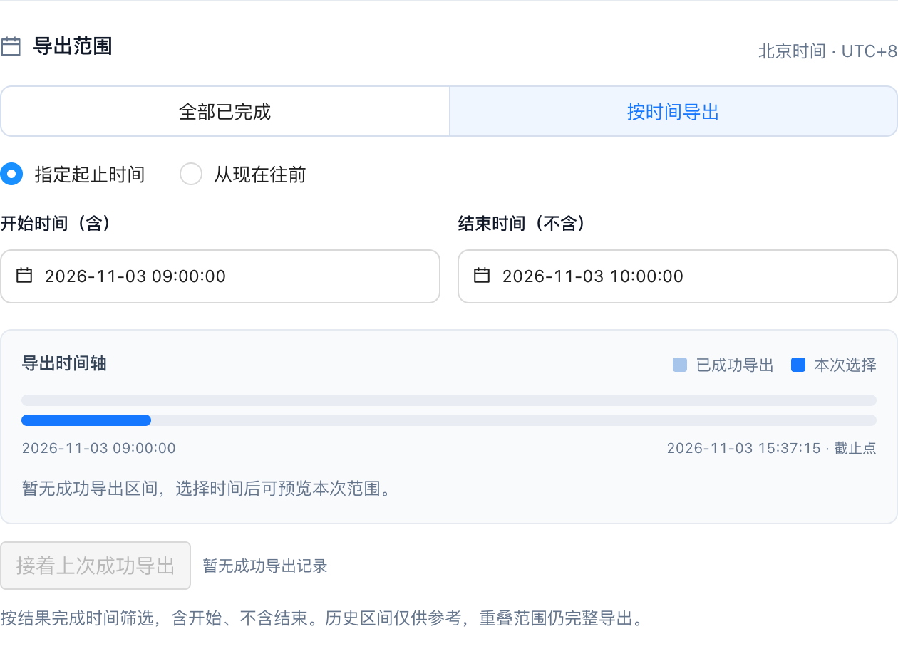
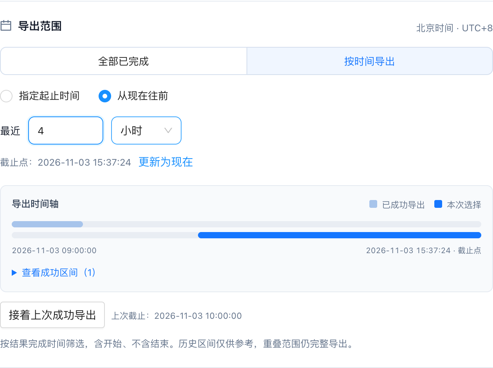
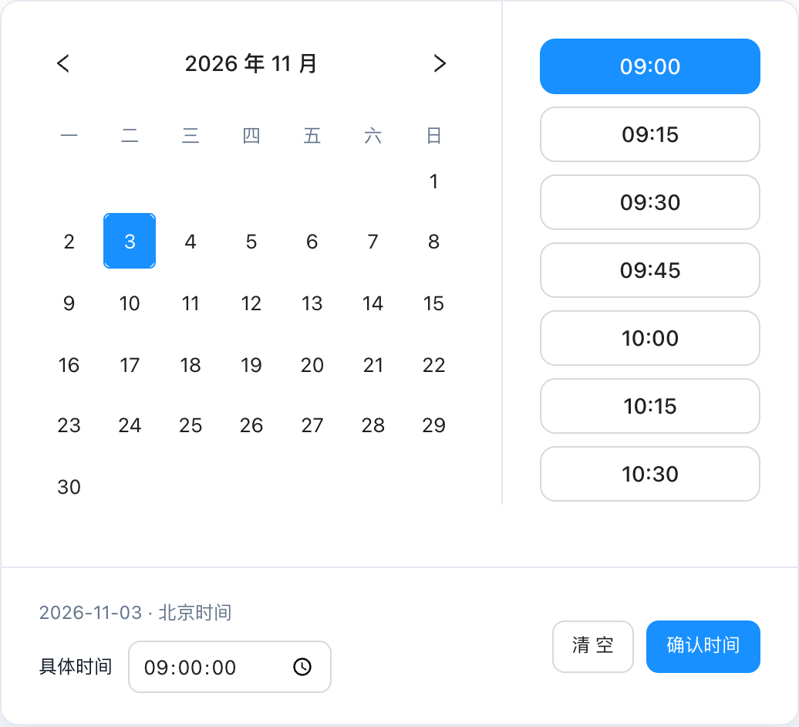
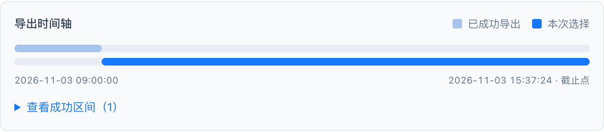
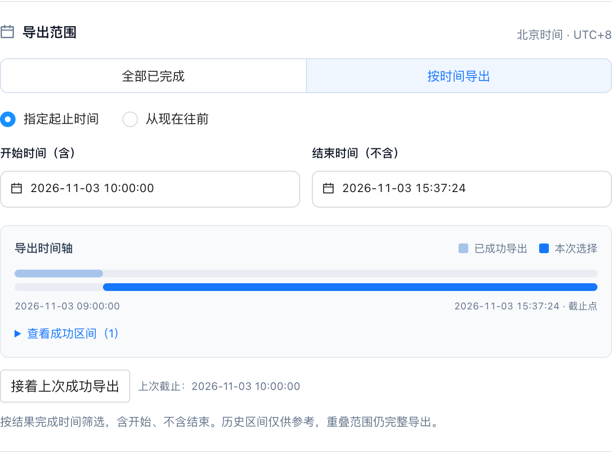
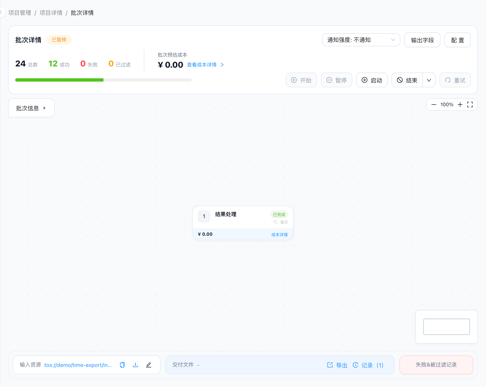
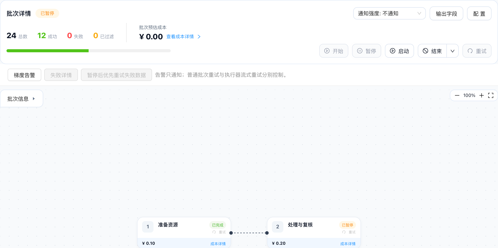
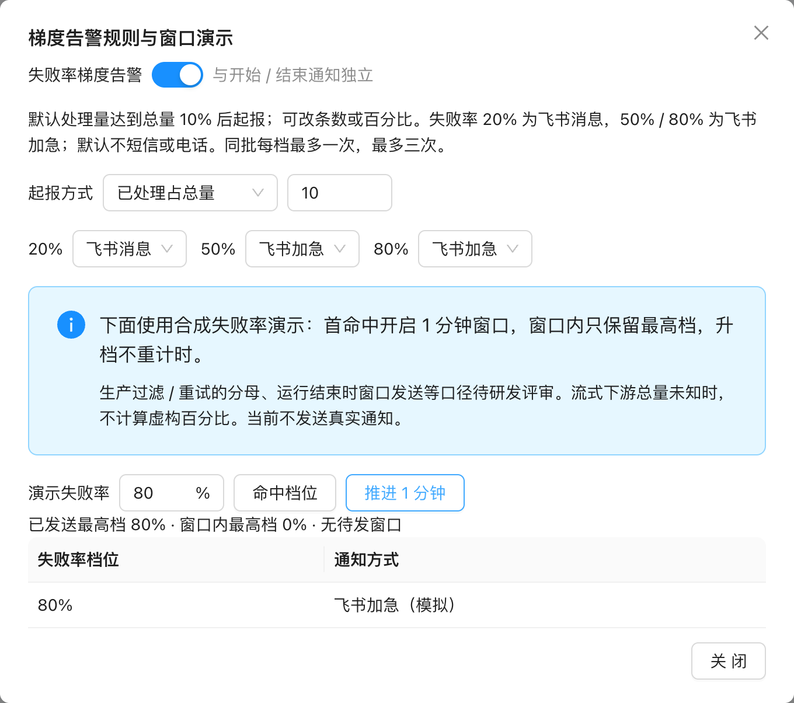

# 批次共用能力：重试、告警与交付导出

# 一、文档说明

## 基本信息

| 项目 | 内容 |
|---|---|
| 所属项目 | 机器标注平台／普通批次与执行器共用能力 |
| 状态与版本 | v2026.11.03 整合评审稿；产品规则已按本轮批准方案统一，生产能力未验收 |
| 负责人／排期 | 待确认；不得从会议计划推断上线 |
| 资源 | 产品、设计、前后端、测试；投入待确认 |
| 上下钻入口 | [需求总览](https://fyze31atzb.feishu.cn/docx/BzMZd9CVLoNxtPxx4b2czeronse) · [执行器二期](https://fyze31atzb.feishu.cn/wiki/VTzeweL4IiJ5WDkkV77cs5G2nNd) · [批次共用能力](https://fyze31atzb.feishu.cn/docx/VZwGd6aUioGjAjxYhupcVW3hnPh) · [一期基础](https://fyze31atzb.feishu.cn/wiki/PoWywcoIcim273kN4G7c2TBInnd) |

## 文档版本

| 版本 | 变化 | 来源 |
|---|---|---|
| 2026-10-19 | 二期旧云稿；固定金额、成功率与补救规则有历史冲突 | 原云文档版本历史 |
| 2026-10-21／22 | 有限首轮后重试、原位补救及共用优化修正 | 本地最终修改包、10/22会议及优化文档 |
| 2026-11-03 原导出稿 | 时间区间重叠完整导出、原快照重试 | 同日交付反馈，原导出文档 |
| 2026-11-03 本次整合 | 总览＋两份详稿；公式成品预算、模式拆分、范围与原型同步 | 用户逐项确认与批准实施计划 |

原文保留在飞书版本历史及本地写入前快照。第四章为实施主规则，附录说明变更来源与未决项；截图来自当前整合原型，合成数据不代表生产服务已接入。

# 二、需求背景

原来“运行、重试、告警优化”和“文件排序与时间导出”分别维护，容易把普通批次暂停后重试、整批执行器放行接续和流式自动重试混为一谈。本稿合并共用规则，保留已确认的时间导出交互和有效图片，并标出三类运行对象的适用边界。

# 三、需求范围

| 优先级 | 范围 |
|---|---|
| P0 共用 | 导出／下载／记录语义、排序、全部与时间范围、时间轴、快照重试、进度反馈 |
| P0 运行补充 | 普通批次暂停后优先失败重试、节点状态和定位、失败率梯度告警、三种结束方式 |
| 需评审／后置 | 未定义的告警分母与窗口异常、后端快照超时、运行中并发重试、跨工作流恢复 |

本稿不定义流式成本预算公式与执行器自动重试门槛，直接引用二期E03—E09。

# 四、详细说明

## 4.1 核心业务流程与适用规则

| 能力 | 普通批次 | 整批执行器 | 流式执行器 |
|---|---|---|---|
| 暂停后优先重试 | 当前工作流内，失败优先后未开始 | 执行器三模式统一调度，不能绕过控制 | 不套普通批次按钮；有限首轮后自动重试或执行器级接管 |
| 就绪结果／文件接续 | 保留处理结果与必要输入 | 放行且收尾文件成功后接续 | 消费可读就绪结果，与主动导出解耦 |
| 主动导出 | 不暂停运行，不启动其他批次 | 不视为放行，不启动下游 | 不驱动下游，不锁住持续生产 |
| 梯度告警 | 已定义口径后按批次通知 | 同批梯度与三模式分开 | 总量未知时不假算百分比；复用批次告警，不新增整链暂停 |
| 成本响应 | 沿原基准 | 保留三模式，不引入公式停机 | 二期公式预算、提醒和有序收尾 |

交付主流程：选环节／批次→全部或按北京时间范围→确认冻结快照→生成→从记录下载；失败在原任务重试同一快照，下载不新增任务。重叠时间范围完整导出，不自动扣掉历史。

## 4.2 功能详细说明

| **序号** | **模块** | **功能** | **功能详细说明** | **用户故事** | **交互/原型图** |
|---|---|---|---|---|---|
| 1 | 交付操作 | C01 区分导出、下载与记录 | **操作与系统响应：** 执行器的“导出结果”与“导出记录”分开排列；批次“交付文件”区域的“导出”使用向外箭头图标，表示创建新的文件任务。；已有文件的下载仍使用向下箭头；历史文件从“交付文件→记录”选择对应任务下载。 **系统记录：** 点击导出入口仅打开配置，不创建记录；确认生成后才新增导出任务。 **异常：** 生成中或失败的文件不得下载；没有已生成文件时不展示可用下载动作。 **完成标准：** C01-A1：导出与记录间距至少10px，窄屏允许换行；导出图标与下载图标不同，文字与动作一致。 | 作为交付人员，我希望区分生成新文件与下载已有文件，以便正确选择操作并避免重复导出。 |   |
| 2 | 文件排序 | C02 面向业务的排序配置 | **操作与系统响应：** 将“统一结束配置”改为“交付文件排序”。；说明“需要与输入顺序一致时选排序；无需保持顺序时选不排序，文件生成更快”；删除原有多余生效范围提示。；单次导出仍可独立选择排序；执行器统一修改只作用于尚未开始收尾的环节，已开始任务与历史不变。 **系统记录：** 保留执行器默认值、批次覆盖值，以及每次导出快照的排序选择。 **异常：** 保存失败提示重试；已锁定的收尾批次不受统一配置修改影响。 **完成标准：** C02-A1：无需了解“收尾”等实现术语即可理解取舍；刷新后配置保留，单次配置不篡改历史。 | 作为交付人员，我希望知道保持输入顺序与生成速度的取舍，以便按核对需要选择文件顺序。 |  |
| 3 | 执行配置 | C03 补足配置按钮点击空间 | **操作与系统响应：** “输入及执行器配置”按钮用边框包住图标和文字，四周留出点击区域；点击任一部分都打开同一个配置弹窗。；首次启动后输入、运行方式与链路锁定；流式预算变更使用专用确认入口，不开放整批判定参数。 **系统记录：** 本项不新增业务记录，沿用配置弹窗原有保存与取消行为。 **异常：** 运行中仍沿用既有禁用规则；换行不遮挡图标或文字。 **完成标准：** C03-A1：左右内边距均至少10px，点击区域高度至少32px；桌面与手机均可打开配置。 | 作为执行器操作者，我希望配置入口容易点击，以便准确打开本次执行设置。 |  |
| 4 | 结果导出 | C04 全部已完成结果导出 | **操作与系统响应：** 导出范围一级仅有“全部已完成”和“按时间导出”；默认选择全部已完成。；全部已完成导出提交时已完成的成功结果，允许批次继续运行；执行器默认最终环节，也可切换中间环节。 **系统记录：** 保存所选批次／环节与全部范围快照，不补造历史逐条结果。 **异常：** 没有可导出成功结果或历史缺少逐条明细时禁止生成并说明原因；切换环节后数量与来源随之更新。 **完成标准：** C04-A1：独立示例显示12条；默认最终环节没有完成结果时禁用生成，切换有结果的中间环节后可导出。 | 作为交付人员，我希望一次导出当前已完成的结果，以便在处理尚未结束时先完成阶段性交付。 |  |
| 5 | 时间导出 | C05 指定明确起止时间 | **操作与系统响应：** 选择“按时间导出→指定起止时间”，分别填写开始与结束日期时间，精确到秒。；按所选环节的结果完成时间筛选；含开始、不含结束，统一北京时间。；切换环节清空手动起止，避免误沿用其他环节范围。 **系统记录：** 记录绝对开始时间、绝对结束时间与结果快照；用户选择重叠区间时不自动排除历史结果。 **异常：** 时间缺失、开始不早于结束、结束晚于当前时间或区间内无成功结果时禁止生成，保留已填内容便于修正。 **完成标准：** C05-A1：09:00—10:00导出6条，10:00的结果不纳入；浏览器切到洛杉矶时区，范围与结果仍一致。 | 作为交付人员，我希望按明确的完成时间区间导出，以便与每次交付约定的时间口径一致。 |  |
| 6 | 时间导出 | C06 从现在往前一段时间 | **操作与系统响应：** 选择“从现在往前”，输入正数时长并选择分钟、小时或天。；以打开导出弹窗时的时间作为本次截止点，明确展示；点击“更新为现在”刷新截止点。；按截止点减去时长得到开始时间；提交后按绝对范围固定，不因时间继续流逝而改变。 **系统记录：** 保存换算后的绝对起止时间；分钟为60秒、小时为60分钟、天为24小时。 **异常：** 时长为空或非正数、范围内无结果时禁止生成；小数时长可输入，不新增未经确认的业务上限。 **完成标准：** C06-A1：截止12:00选择最近3小时，范围为09:00—12:00；提交与历史记录显示相同绝对范围。 | 作为交付人员，我希望快速导出最近一段时间的结果，以便减少反复计算起止时间。 |  |
| 7 | 时间导出 | C07 日历与时间预设选择 | **操作与系统响应：** 按用户提供的Calendar with time presets适配：桌面左日历、右滚动预设、底部日期摘要与确认；小屏预设移至日历下。；支持翻月、选择日期、09:00—18:00每15分钟一个预设，共37项；另可输入00:00:00—23:59:59任意时分秒。；日期与时间先更新草稿，确认后回填；清空删除边界，关闭浮层不保存未确认草稿，浏览月份不改变已选日期。 **系统记录：** 仅确认后更新表单值；本控件本身不创建导出任务。 **异常：** 无效时分秒不可确认；不继承参考中预约日期禁选规则；视口空间不足时居中并允许内部滚动。 **完成标准：** C07-A1：1440／768／390宽度无横向越界，翻月、选择预设、任意秒、清空和确认均可操作，手机确认按钮可达。 | 作为交付人员，我希望用直观的日历和时间预设选取边界，以便快速、准确地设置交付范围。 |  |
| 8 | 交付历史 | C08 成功导出时间轴 | **操作与系统响应：** 按当前所选批次展示历史成功区间与本次选择，两行区分；可展开查看每次成功任务的准确范围。；仅成功任务计入历史时间轴；生成中与失败任务不算已交付；时间轴是参考，不承诺中间空档均已交付。 **系统记录：** 使用已有任务的范围、状态和快照时间，不创建额外“已交付”数据。 **异常：** 没有成功记录时显示空状态；切换环节后只显示对应环节记录，不混用其他批次。 **完成标准：** C08-A1：09:00—10:00任务成功后该区间显示为历史；失败或生成中任务不新增成功区间。 | 作为交付人员，我希望看到已成功导出的时间段，以便判断下一次该选哪段时间。 |  |
| 9 | 交付历史 | C09 接着上次成功导出 | **操作与系统响应：** 点击“接着上次成功导出”，用当前批次所有成功任务中最靠后的截止点作开始、本次截止点作结束，切回明确起止方式。；不按最近点击任务计算；历史空档可手动补导，手动重叠范围仍完整导出。；兼容旧含结束任务：从该端点后1毫秒开始；全部结果快照从快照后1毫秒开始，避免已包含端点重复纳入。 **系统记录：** 提交时记录新的绝对区间与快照；原成功记录不修改。 **异常：** 无成功记录或截止点之后暂无可用时间时禁用；生成中和失败任务不推进接续边界。 **完成标准：** C09-A1：09:00—10:00成功后，接续到12:00得到另外6条，包含原区间排除的10:00结果；多记录取最靠后成功截止点。 | 作为连续交付人员，我希望从已成功交付的截止点继续导出，以便少算时间边界并减少漏选。 |  |
| 10 | 导出任务 | C10 快照、记录与下载 | **操作与系统响应：** 确认“生成交付文件”后立即创建任务，固定本次结果成员、字段值和排序；之后完成的数据留给下次。；在“交付文件→记录”查看状态与下载成功文件；失败重试沿用原记录与快照，追加尝试次数；再次下载不新增任务。；主动导出不暂停处理、不触发下游。整批仅放行后的收尾文件成功才接续；流式消费成功且可读的就绪结果，不依赖交付文件。 **系统记录：** 记录任务标识、批次／执行器／环节、发起人、触发方式、范围、快照时间、成员、排序、状态、失败原因、资源与尝试记录。 **异常：** 生成中禁止下载；失败保留结果且允许重试文件生成；历史缺明细不得伪造新快照，原交付资源仍可查看。 **完成标准：** C10-A1：下载内容与快照条数、字段和排序一致；重试不重跑数据、不增加同一任务记录；刷新保留任务与进度。 | 作为交付人员，我希望每次文件有明确的范围、结果快照和记录，以便下载正确版本并追查失败。 |  |
| 11 | 导出反馈 | C11 完成后收起进度区 | **操作与系统响应：** 运行中保留文件生成进度；任务成功完成后，该任务的进度区自动消失，不停留“导出成功＋下载文件”。；进度区不提供下载入口；文件在上方交付文件与对应导出记录中获取。；多个任务独立按状态展示，某个任务成功只移除该任务反馈；其他生成中或失败任务不受影响。 **系统记录：** 仅改变进度展示，成功任务、文件资源和历史记录完整保留。 **异常：** 失败仍显示错误及重试入口，避免把失败误当成功隐藏；没有任务时不展示空进度卡片。 **完成标准：** C11-A1：成功后页面找不到该任务进度卡片；记录中仍可下载正确文件，刷新后也不恢复成功进度卡片。 | 作为交付人员，我希望完成后进度提示自动收起，以便页面保持清晰并在统一位置查找文件。 |   |
| 12 | 失败重试 | C12 普通批次按最终失败范围恢复 | **操作与系统响应：** 普通工作流未结束时可先暂停，再重试；失败数据优先，完成后继续尚未开始的数据，同一数据不并发处理。；点击某算子重试即将其作为恢复起点；范围按整个工作流最终失败记录，排除全流程成功与正常过滤。允许前面曾成功的算子为下游失败重新生成URL，不新增两步选择范围弹窗。；仅当前工作流内。整批执行器由三模式统一调度；流式自动／人工补救参见二期E08／E09，不承诺运行中并发重试。 **系统记录：** 保存起始节点、失败范围快照、输入准备阶段、恢复轮次和处理结果；不把节点本地成功误当全流程成功。 **异常：** 只有rowkey标记时可能需要全量扫描；展示等待／准备中和失败原因，不承诺精准即时取回完整输入。输入不足、重复任务或结束收尾中阻断重复提交。 **完成标准：** C12-A1：前节点成功、后节点失败时，可从前节点重跑该失败记录。；C12-A2：成功和正常过滤不重跑，失败优先于尚未开始；准备中刷新状态保留。 | 作为异常处理人员，我希望暂停后优先恢复真正失败的数据，以便先补齐交付而不重跑成功结果。 |   |
| 13 | 状态展示 | C13 暂停节点与失败位置 | **操作与系统响应：** 暂停批次时，已完成节点维持已完成，其他节点显示已暂停，避免批次暂停而画布仍像运行中。；沿现有失败详情弹窗增加具体“节点”列，能对应画布中具体算子；多个同类型节点也可区分，不新增第二个弹窗。 **系统记录：** 保留批次状态、节点标识、节点名称及错误记录关联，不改写已完成节点的结果。 **异常：** 历史缺少节点标识时显示无法定位，不能按同类名称猜测；历史“已开发／测试环境／计划上线”不等于生产已验收。 **完成标准：** C13-A1：暂停画布已完成仍完成，其余暂停。；C13-A2：失败详情节点唯一对应画布；原型展示暂停与合成节点定位，真实错误明细服务待联调。 | 作为排障人员，我希望状态与具体失败节点一致，以便准确定位需要处理的位置。 |   |
| 14 | 梯度告警 | C14 失败率告警配置与适用范围 | **操作与系统响应：** 默认开启失败率梯度告警，与普通开始／结束通知独立；起报默认已处理达到当前批次总量10%，可按条数或百分比配置。10%是处理量门槛，不是失败率。；默认失败率20%飞书消息、50%和80%飞书加急；允许修改提醒方式，默认不短信或电话。仅通知，不增加成功率不足即整链暂停。；普通批次和执行器批次均可使用。流式后序总量未知时不得假算百分比起报；条数门槛及未知总量提示应可配置，具体降级规则待确认。 **系统记录：** 保存启用状态、起报方式／门槛、各档提醒方式，与批次通知基准分别存储。 **异常：** 过滤／重试是否进入分子分母、总量变化口径未确认；生产统计接口需明示口径。原型告警窗口使用手动合成失败率，不伪称真实运行统计已接入。 **完成标准：** C14-A1：区分处理量10%与失败率档位，关闭梯度不改变开始／结束通知。；C14-A2：流式未知总量不能显示伪造百分比；提醒不暂停执行。 | 作为值守人员，我希望按失败严重程度收到合适提醒，以便关注异常而不用持续盯盘。 |  |
| 15 | 梯度告警 | C15 一分钟窗口合并与防重复 | **操作与系统响应：** 首次满足起报门槛并命中档位时开1分钟窗口，只保留窗口内最高档；升档不重新计时，窗口结束只发最高档。；之后达到更高且未发档位再开1分钟窗口。同批每档最多一次，发高不补低；恢复或重试不清已发最高档，最多3次，不跨批合并。 **系统记录：** 记录批次、窗口开启／截止、待发最高档、已发档位和提醒结果，刷新不清重。 **异常：** 窗口内运行结束是否发送、规则修改后的已发档行为及通知失败重发规则待评审；不凭会议建议补成已定行为。 **完成标准：** C15-A1：20%命中后30秒升80%，仍在原第60秒只发80%。；C15-A2：再降50%或重试后回80%不重发，最高档与记录保留。 | 作为值守人员，我希望短时间告警合并且不重复，以便看到最严重问题而不被刷屏。 |  |
| 16 | 结束与快照 | C16 三种结束方式与输入保留 | **操作与系统响应：** 普通批次提供有序生成／无序生成／不生成交付文件；下拉仅选本次配置，点击主结束按钮才执行，不回写Flow默认。；不生成文件仍保留处理结果和必要下游输入。整批执行器中间环节当前依赖收尾文件，不能无文件结束；流式不靠文件推进，可独立导出。；快照动作前端不设置业务超时，不把前端不超时当后端网关必定不限时。 **系统记录：** 记录本次结束配置、收尾输入范围、文件任务与处理结果；历史交付文件保留。 **异常：** 后端／网关超时、失败恢复与真实无文件输入读取协议待联调；无可导出成功结果不伪造文件。 **完成标准：** C16-A1：选下拉不立即结束；点击主按钮才生效。；C16-A2：无文件仍能保留结果后续主动导出；整批依赖文件和流式就绪结果规则分别验收。 | 作为运行人员，我希望按本次交付需要选择结束方式，以便保留结果并控制生成文件的成本。 |  |

## 4.3 验收场景与状态

| 场景 | 可观察结果 |
|---|---|
| 整批兼容 | 默认失败待处理、严谨每批确认、目标有限重试；收尾文件成功再接续 |
| 样本与成品单位 | 样本跑完整链路，保留费用与产物，一对多按最终份数；零成品不可估算 |
| 预算更新 | 未确认不改生效预算；确认历史可核对 |
| 提醒与收尾 | 提前提醒继续；预算达限不新增，收尾费用可超额且可拆解 |
| 重试与补救 | 首轮后有限评估；扫描准备可见；人工接管同实例，不重跑成功与正常过滤 |
| 克隆隔离 | 配置可复用、输入可选、字段需按新输入核对；新批次费用进度结果为空 |
| 导出与恢复 | 重叠完整、原快照重试、主动导出无接续；刷新保留状态 |

# 五、非功能需求

- 兼容性：旧数据缺运行方式按整批解释；保留已有本地数据、历史结果与交付资源。写入采用可选字段扩展，不清库。
- 一致性：成功结果下传、预算确认、重试与导出需幂等；生产跨服务一致性与费用延迟阈值待研发定义，原型不承诺SLA。
- 可用性：桌面与390px窄屏关键弹窗／确认操作可达，错误保留已填内容；刷新后恢复暂停、预算、进度与任务快照。
- 原型边界：合成数据、模拟服务、浏览器保存，关闭页面不补跑。真实模型调用、费用结算、飞书通知、稳定CID、完整输入扫描、字段推导与生产重试接口均待联调。

# 六、埋点

本轮不新增产品行为埋点。预算确认、费用触发、重试、输入准备、补救与导出记录属于必需的运行记录，不能用点击埋点替代。

# 附录

## 附录 A：逐项变更与来源等级

| 编号 | 旧规则／冲突 | 新结论 | 来源与性质 | 调整原因 | 验收关联 |
|---|---|---|---|---|---|
| D01 | 固定总额／输入数×单价 | 最终成品预测×期望成品单价；人工确认 | 用户确认，2026-11-03；10/23用户原话、11/2成本会议为依据 | 转化可一对多，输入不是成品 | E04-A1、E05-A1 |
| D02 | 每批判定套流式 | 整批三模式；流式独立策略 | 用户确认，2026-11-03；一期当前路径 | 避免流式反复待人工 | E01-A1、E06-A1 |
| D03 | 样本另算／直接生产 | 同实例样本、费用累计、产物保留、不重跑 | 用户批准计划，2026-11-03 | 先验证转化且费用不漏算 | E03-A2 |
| D04 | 预计够量即停止／动态补货 | 固定输入；预计成品量仅预算依据 | 用户确认，2026-11-03；10/29会议仅补充目标来源 | 预算预测不能冒充产量目标 | E06-A2 |
| D05 | 达上限立即停所有处理／保证封顶 | 停新增取入与新增重试，已取入收尾可超额 | 用户确认，2026-11-03 | 保住已投入数据，说明追加费用 | E07-A1、E07-A2 |
| D06 | 无限重试／逐批重试／成功率整链暂停 | 有限次数、首轮全链结束后评估，保留正常过滤 | 10/21本地最终确认稿；本次批准沿用 | 控制无收益重试，区分成本和成功率 | E08-A1、E08-A2 |
| D07 | 独立补救执行器 | 执行器级接管，同实例原位补救 | 10/21本地最终确认稿；本次批准沿用 | 费用、CID与交付历史连续 | E09-A2 |
| D08 | 只有rowkey即可立即精准恢复 | 输入扫描准备状态；运行中并发重试不承诺 | 11/3重试会议，研发限制／技术方案未定 | 标记不含完整输入，交互不能绕开扫描 | C12-A2 |
| D09 | 导出排除历史重复结果 | 重叠区间完整导出，接续取最靠后成功截止 | 11/3导出原稿及用户批准 | 手动重叠是主动完整交付意图 | C05-A1、C09-A1 |
| D10 | 失败重建范围／主动导出驱动下游 | 原任务原快照重试；主动导出无调度副作用 | 11/3导出原稿及本次批准 | 防止结果漂移和意外接续 | C10-A1 |
| D11 | 全部模式导出成功才接续 | 仅整批依赖收尾文件；流式就绪即消费 | 用户确认，2026-11-03 | 保障提前产出 | E06-A1、C16-A2 |
| D12 | 完整逐条／跨平台链路均本期 | 必要关联本期，完整追溯后置 | 用户确认；11/2追溯会议为建议与成本依据 | 控制二期范围 | E10-A1 |
| D13 | 克隆只列一句／继承旧结果字段 | 展开独立需求与排期，配置继承、字段重算、结果隔离 | 10/23用户session及本次批准 | 避免旧输出污染新输入 | E11-A1、E12-A1 |
| D15 | 整合时可能漏掉未冲突的确认项 | 保留固定成本反馈、全局通知、环节暂停与人工继续 | 10/21最终确认稿；本次整合核查 | 避免删掉仍有效的需求 | E13-A1、E14-A1、E09-A1 |
| D14 | 运行／导出／告警多篇同时有效 | 总览＋二期＋共用；旧优化稿转历史导航 | 用户确认，2026-11-03 | 消除多套有效规则 | 三文档互链及迁移指引回读 |

## 附录 B：来源核对

- **已确认决定**：本轮用户逐项确认及批准实施计划（2026-11-03）；10/21最终修改包；11/3导出反馈。会议的新建议不得覆盖这些决定。
- **历史基线**：一期当前云稿、10/19二期旧稿、10/21本地最终核对稿、10/22共用优化文档。10/21修正未进入旧云稿，因此旧云稿不能单独当最新规则。
- **会议建议**：11/2成本与转化会议（OpenViking meeting-3f239a9eaa0d0b57，源src-9279de8c54819b47）；11/2追溯会议（meeting-1fd06871610053b0）；10/29目标口径会议（meeting-8083ea651aac643a）。它们解释风险和边界，不代表生产方案已定。
- **研发限制**：11/3重试会议（meeting-f463d21c6e99c00a，源src-d05d9833a16bbc07）：只存rowkey不等于保存完整输入，需扫描且存在内存／资源成本；未形成即时精准恢复方案。
- **迭代session**：10/23克隆与预算用户原话，以及OpenViking「执行器扩展延后安排确认」「讨论执行器克隆配置继承与输入依赖风险」；会议推导稿中的模板设想不是当前批准范围。

## 附录 C：待确认与生产依赖

| 待确认项 | 当前处理 | 关闭条件 |
|---|---|---|
| 样本代表性、抽样方法与不足判断 | 不设未经批准的规模默认或统计阈值；原型4条仅演示 | 产品／算法／研发评审，明确可解释依据与补充验证方法 |
| 实际与未结算费用、延迟、提醒送达 | 原型固定合成单价，不承诺实时封顶 | 成本服务提供可核对口径并联调触发与收尾 |
| 可读结果、稳定CID与消费幂等 | 原型本地资源标识，必要关联先行 | 研发确认可靠读写和重复消费恢复协议 |
| 输入扫描恢复、错误分类粒度 | 展示准备阶段，不承诺运行中精准并发 | 研发验证输入存储／扫描方案及资源开销 |
| 告警过滤／重试分母、总量变化、窗口结束及改规则 | 规则待评审，演示用人工合成失败率 | 产品与研发确认统一口径和边界 |
| 克隆逐项配置回退与字段依赖推导 | P1独立排期；原型整组预览，真实字段校验待联调 | 研发评审回退粒度、真实依赖与新资源绑定 |
| 后端快照网关超时、旧时间端点精度 | 前端不新增业务超时；+1ms为旧原型兼容，生产精度待定 | 后端、测试验证契约；不能当作已上线 |
| 负责人、资源、排期与生产验收 | 待确认，无虚构日期或SLA | 需求评审确定具名负责人及排期 |

## 附录 D：需求—原型—截图—验收映射

原型参数为合成场景，不是业务默认值。各图位于对应功能行；未接生产能力按本稿验收但不声称已经实现。

| 需求编号 | 可操作场景 | 截图文件 | 验收项 |
|---|---|---|---|
| C01 | [区分导出、下载与记录](https://isaac-some.github.io/Machine-Annotation-Platform-Product-Prototype-Demo/hawk/project/batch/?id=234&batchId=5889&example=delivery) | 01-export-actions、12-delivery-icons | C01-A1：导出与记录间距至少10px，窄屏允许换行；导出图标与下载图标不同，文字与动作一致。 |
| C02 | [面向业务的排序配置](https://isaac-some.github.io/Machine-Annotation-Platform-Product-Prototype-Demo/hawk/project/batch/?id=234&batchId=5889&example=delivery) | 02-file-order | C02-A1：无需了解“收尾”等实现术语即可理解取舍；刷新后配置保留，单次配置不篡改历史。 |
| C03 | [补足配置按钮点击空间](https://isaac-some.github.io/Machine-Annotation-Platform-Product-Prototype-Demo/hawk/project/batch/?id=234&batchId=5889&example=delivery) | 03-configuration-hit-area | C03-A1：左右内边距均至少10px，点击区域高度至少32px；桌面与手机均可打开配置。 |
| C04 | [全部已完成结果导出](https://isaac-some.github.io/Machine-Annotation-Platform-Product-Prototype-Demo/hawk/project/batch/?id=234&batchId=5889&example=delivery) | 04-all-completed | C04-A1：独立示例显示12条；默认最终环节没有完成结果时禁用生成，切换有结果的中间环节后可导出。 |
| C05 | [指定明确起止时间](https://isaac-some.github.io/Machine-Annotation-Platform-Product-Prototype-Demo/hawk/project/batch/?id=234&batchId=5889&example=delivery) | 05-absolute-window | C05-A1：09:00—10:00导出6条，10:00的结果不纳入；浏览器切到洛杉矶时区，范围与结果仍一致。 |
| C06 | [从现在往前一段时间](https://isaac-some.github.io/Machine-Annotation-Platform-Product-Prototype-Demo/hawk/project/batch/?id=234&batchId=5889&example=delivery) | 06-recent-window | C06-A1：截止12:00选择最近3小时，范围为09:00—12:00；提交与历史记录显示相同绝对范围。 |
| C07 | [日历与时间预设选择](https://isaac-some.github.io/Machine-Annotation-Platform-Product-Prototype-Demo/hawk/project/batch/?id=234&batchId=5889&example=delivery) | 07-calendar | C07-A1：1440／768／390宽度无横向越界，翻月、选择预设、任意秒、清空和确认均可操作，手机确认按钮可达。 |
| C08 | [成功导出时间轴](https://isaac-some.github.io/Machine-Annotation-Platform-Product-Prototype-Demo/hawk/project/batch/?id=234&batchId=5889&example=delivery) | 08-timeline | C08-A1：09:00—10:00任务成功后该区间显示为历史；失败或生成中任务不新增成功区间。 |
| C09 | [接着上次成功导出](https://isaac-some.github.io/Machine-Annotation-Platform-Product-Prototype-Demo/hawk/project/batch/?id=234&batchId=5889&example=delivery) | 09-continuation | C09-A1：09:00—10:00成功后，接续到12:00得到另外6条，包含原区间排除的10:00结果；多记录取最靠后成功截止点。 |
| C10 | [快照、记录与下载](https://isaac-some.github.io/Machine-Annotation-Platform-Product-Prototype-Demo/hawk/project/batch/?id=234&batchId=5889&example=delivery) | 10-export-record | C10-A1：下载内容与快照条数、字段和排序一致；重试不重跑数据、不增加同一任务记录；刷新保留任务与进度。 |
| C11 | [完成后收起进度区](https://isaac-some.github.io/Machine-Annotation-Platform-Product-Prototype-Demo/hawk/project/batch/?id=234&batchId=5889&example=delivery) | 11-progress、13-completed | C11-A1：成功后页面找不到该任务进度卡片；记录中仍可下载正确文件，刷新后也不恢复成功进度卡片。 |
| C12 | [普通批次按最终失败范围恢复](https://isaac-some.github.io/Machine-Annotation-Platform-Product-Prototype-Demo/hawk/project/batch/?id=234&batchId=5889&example=delivery) | 13-batch-retry、14-batch-scan | C12-A1：前节点成功、后节点失败时，可从前节点重跑该失败记录。；C12-A2：成功和正常过滤不重跑，失败优先于尚未开始；准备中刷新状态保留。 |
| C13 | [暂停节点与失败位置](https://isaac-some.github.io/Machine-Annotation-Platform-Product-Prototype-Demo/hawk/project/batch/?id=234&batchId=5889&example=delivery) | 18-paused-nodes、20-failure-detail | C13-A1：暂停画布已完成仍完成，其余暂停。；C13-A2：失败详情节点唯一对应画布；原型展示暂停与合成节点定位，真实错误明细服务待联调。 |
| C14 | [失败率告警配置与适用范围](https://isaac-some.github.io/Machine-Annotation-Platform-Product-Prototype-Demo/hawk/project/batch/?id=234&batchId=5889&example=delivery) | 12-alarm | C14-A1：区分处理量10%与失败率档位，关闭梯度不改变开始／结束通知。；C14-A2：流式未知总量不能显示伪造百分比；提醒不暂停执行。 |
| C15 | [一分钟窗口合并与防重复](https://isaac-some.github.io/Machine-Annotation-Platform-Product-Prototype-Demo/hawk/project/batch/?id=234&batchId=5889&example=delivery) | 12-alarm | C15-A1：20%命中后30秒升80%，仍在原第60秒只发80%。；C15-A2：再降50%或重试后回80%不重发，最高档与记录保留。 |
| C16 | [三种结束方式与输入保留](https://isaac-some.github.io/Machine-Annotation-Platform-Product-Prototype-Demo/hawk/project/batch/?id=234&batchId=5889&example=delivery) | 19-finish-options | C16-A1：选下拉不立即结束；点击主按钮才生效。；C16-A2：无文件仍能保留结果后续主动导出；整批依赖文件和流式就绪结果规则分别验收。 |
